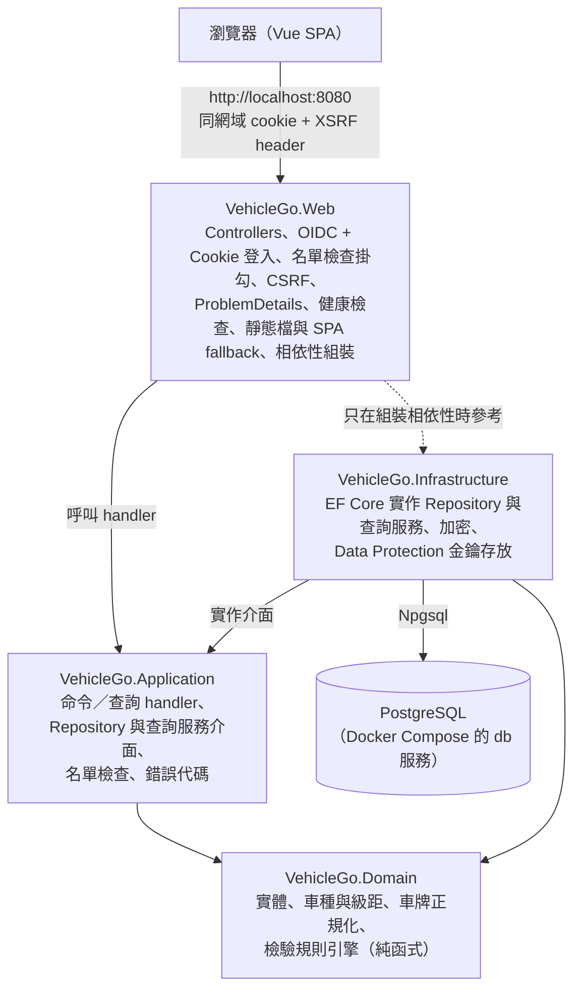

# 個人車輛管理系統（第一版：檢驗期間）

*   **Author:** tsengyuchen
*   **Status:** Proposed
*   **Date:** 2026-11-19

--------------------------------------------------------------------------------

## Overview

一個網頁版的個人車輛管理系統。使用者用 Google 帳號登入，登錄自己擁有的汽機車；系統依台灣法規，在每次讀取時算出每台車每種檢驗（定期檢驗、排氣定檢）的下一個檢驗期間，顯示在網頁上。

第一版只做「車輛資料 + 檢驗期間」：
- 刻意不做通知、管理頁、帳號刪除和逾期判斷，目的是先驗證規則的實作符合作者對法規的理解（法規本身的正確性見 [Risks & Mitigations](#risks--mitigations)）。
- 只開放給環境變數名單上的 Google 帳號。
- 只部署在作者本機的 Docker 當作測試環境，正式的 VPS 部署延後。

之後可能會加入保養紀錄、加油紀錄，但第一版不為之後的功能預先寫程式（不預建資料表、API 或畫面）。
- **例外：** 作者想先收集、之後會用到的資料，第一版可以先收集。
- **目前的例子：** 排氣量級距。第一版的檢驗規則用不到它，但作者決定必填並驗證：汽車級距照牌照稅級距，供之後計算牌照稅；機車級距依車種分級，只作紀錄（見 Technical Plan 第 2 節的對照表）。排氣量不是個資。
- **成本：** 先收集資料會有驗證、欄位和日後資料遷移的成本；若是個資，還要符合「只收集必要資料」的原則，所以每筆要先收集的資料都要個別評估。

技術：ASP.NET Core Web API（後端採用 Clean Architecture，遵守 SOLID；其中依賴方向由專案參考和架構測試強制）+ Vue SPA + PostgreSQL，用 Docker Compose 部署；介面只有繁體中文。

### 術語

| 用語 | 意思 |
| --- | --- |
| **定期檢驗** | 監理單位依道路交通安全規則第 44 條要求的檢驗（API 代碼 `PERIODIC`）。 |
| **排氣定檢** | 環保單位依空氣污染防制法第 40 條要求的機車排氣檢驗（API 代碼 `EXHAUST`）。 |
| **檢驗期間** | 可以去做某一次檢驗的日期範圍，由「期間起日」到「最後期限」，兩天都包含在內。 |
| **指定檢驗日期** | 行照上印的定期檢驗日期；定期檢驗的檢驗期間是它的前後一個月。使用者可以選填行照上的指定檢驗日期；沒填時由公式算出。 |
| **推算期間** | 滿 10 年後每年第二次的檢驗期間。法規沒有公開算法，系統用「指定檢驗日期 + 6 個月」推算。畫面上的推算標示在 G5 定義。 |
| **大型重型機車** | 排氣量逾 250cc 的燃油機車，簡稱「大型重機」。 |
| **Data Protection 金鑰** | ASP.NET Core 用來簽署和加密登入 cookie 的金鑰。 |
| **查詢服務** | Application 定義、只負責讀取資料的介面（例如 `IVehicleQueries`），和負責寫入的 Repository 相對。 |

## The Problem

台灣的汽機車有兩種強制檢驗，主管機關不同、規則不同，車主要自己記：

- **定期檢驗**（交通部，道路交通安全規則第 44 條）：自用小客車和大型重型機車（逾 250cc）出廠滿 5 年後每年一次，滿 10 年後每年兩次，要在行照上的指定檢驗日期前後一個月內完成。逾期會被處 900–1,800 元罰鍰，逾期 6 個月以上註銷牌照。
- **排氣定檢**（環境部，空氣污染防制法第 40 條）：燃油機車出廠滿 5 年後每年一次，要在原發照月份的前後一個月內完成（例如 3 月發照，期限是 2 月 1 日到 4 月 30 日）。

一個人有多台車時（例如一台汽車、一台機車、一台大型重機），每台車要做的檢驗種類、頻率和檢驗期間都不同，而且會隨車齡改變。監理單位和環保單位雖然會通知，但各自只通知自己的項目，車主看不到「我所有的車接下來各要驗什麼」。

**解法：** 使用者輸入行照上的資料（車種、排氣量、出廠日期、原發照日期，以及選填的指定檢驗日期），系統依法規算出每台車每種檢驗的下一個檢驗期間，並在進入檢驗期間時變色提示。

**這個解法的限制，使用者必須知道：**
- 系統沒有「已驗車」的紀錄，所以不判斷逾期，也不知道使用者是否已經驗過。
- 滿 10 年後每年第二次的檢驗期間，法規沒有公開算法，系統用推算期間表示。
- **「只會提早、不會晚」的原則：** 除了推算期間以外，系統的簡化做法只會讓顯示的最後期限比實際早：(1) 不處理假日順延（顯示的期限可能比實際早幾天）；(2) 行照只有出廠年月時填該月 1 日（車齡算得偏大）；(3) 月份加減落在不存在的日期時取該月最後一天（見[日期計算規則](#3-日期計算規則)）。推算期間可能比實際早，也可能比實際晚。
- 第一次指定檢驗日期的公式（D-R2）只依網路資料整理，作者決定不以真實行照比對。
- 系統只支援 4 種車種（見 G2）。電動大型重型機車、營業用車、貨車等不支援的車種，如果被登錄成支援的車種，算出的檢驗會不正確。

以上都會寫進畫面上的免責聲明，最終文字：「檢驗期間依您登錄的資料計算，僅供參考，請以行照、監理站及環保單位的正式通知為準。期限遇假日可能順延；標示「推算日期」的期間可能比實際早或晚。本系統不會提醒已過期或已完成的檢驗。本系統不支援電動大型重型機車、營業用車及貨車。」

## Goals

*   **G1 登入與名單：** 用 Google OIDC 登入，只申請 `openid email` 權限。只有環境變數 `ALLOWED_EMAILS` 名單上、而且 `email_verified = true` 的帳號能登入。每次請求都重新比對名單：作者從 `ALLOWED_EMAILS` 移除某人並重建 `api` 容器後，該使用者的下一個請求會收到 401。使用者以 Google 的 `sub` 識別。登入 cookie 有效 14 天，有使用就自動延長（ASP.NET Core 預設值）。
*   **G2 車輛管理：** 使用者可以新增、修改自己的車輛，每人最多 50 台（含垃圾桶）。
    *   車種（選單上的標籤）：自用小客車（非營業用）、一般燃油機車、大型重型機車、電動機車（40 馬力以下）。
    *   欄位：車牌、廠牌、型號、暱稱（選填）、顏色（選填）、車種、排氣量級距（電動機車以外必填）、出廠日期、原發照日期、行照上的指定檢驗日期（選填，只限自用小客車和大型重機）。指定檢驗日期欄位的說明文字：「每次驗完車，請改成新行照上的指定檢驗日期。」
    *   同一台車在兩個分頁或裝置被同時修改時，後儲存的一方會被擋下，並提示「資料已被修改，請重新整理」。
*   **G3 垃圾桶：** 刪除時先丟進垃圾桶，可以還原或永久刪除。丟進垃圾桶滿 30 天後就看不到；實際刪除發生在該使用者下一次新增、修改車輛或登入時，或下一次 `api` 啟動時（不需要背景排程，見 Technical Plan 第 2 節）。車牌在同一使用者底下唯一（含垃圾桶），重複時提示去垃圾桶還原。
*   **G4 檢驗期間計算：** 檢驗規則寫在程式裡，在讀取時算出每台車每種適用檢驗的下一個檢驗期間（期間起日、最後期限、狀態、規則 ID、日期來源、是否為推算），不存進資料庫。
    *   有填指定檢驗日期 L 時，定期檢驗以它為準：檢驗期間為 L、L + 1 年、L + 2 年……的前後一個月，顯示最後期限在今天或之後的最早一個；某個指定檢驗日期當天車齡已滿 10 年時，再加一個 + 6 個月的推算期間；L − 1 年當天車齡已滿 10 年時，也補上 L − 6 個月的推算期間（滿 10 年的車驗完後填入新行照上的下一個日期，才不會漏掉中間那一次，見 CUJ 4c）。填過去的日期也可以，系統會自動往後推到下一個檢驗期間。
    *   沒填時，用公式算出第一次指定檢驗日期（D-R2），之後每年同月同日一次；滿 10 年後的推算期間規則和有填時相同（見第 3 節）。
*   **G5 顯示：** 列表可依最後期限（預設）或出廠日排序。進入檢驗期間時日期變色。每個狀態都有文字標籤，不只靠顏色：

    | 狀態 | 何時出現 | 畫面 |
    | --- | --- | --- |
    | `EXEMPT` | 這台車不需要這種檢驗（目前只有電動機車的排氣定檢） | 「免檢」，不變色，沒有日期 |
    | `UPCOMING` | 今天在下一個檢驗期間之前 | 「下次檢驗期間」加日期，不變色 |
    | `IN_WINDOW` | 今天在檢驗期間內（含期間起日和最後期限當天） | 「檢驗期間內」加日期，變色 |
    | `UNCOMPUTABLE` | 規則表沒有對應的規則，或資料庫裡的資料不符合現行驗證 | 「無法計算，請確認車種與日期是否正確；若仍有問題請回報車牌」 |

    推算期間另外顯示**推算標示**，文字固定為「推算日期，請以行照為準」；使用者有填指定檢驗日期（`basis = LICENCE`），而且不是推算期間時，顯示「依行照指定檢驗日期」。依最後期限排序時，依該車所有檢驗中最早的最後期限排序，早的在前，免檢和無法計算排最後，同日依車牌排序；依出廠日排序時，舊的在前，同日依車牌排序。列表上方和車輛詳細頁各顯示一次免責聲明。
*   **G6 日期：** 日期的輸入和顯示可用民國年或西元年，由使用者在個人設定選一次，預設民國；輸入用年、月、日三個下拉選單。時間點以 UTC 存放；日曆日期不轉時區；「今天」用台北時間。
*   **G7 資料保護：** 名單、Google Client Secret、資料庫密碼和 `MASTER_KEY` 都放在不進 git 的 `.env`。使用者的 Email 和 Data Protection 金鑰都以 `MASTER_KEY` 推導出的金鑰加密存放。pre-commit hook 和 CI 都會檢查有沒有密鑰被 commit 進 repo。
*   **G8 部署：** 在本機用 Docker Compose 執行一支部署腳本完成部署。
*   **G9 成功標準：** GitHub Actions CI 中以下四類測試全部通過：
    1. **規則計算的單元測試。** 每個案例的名稱附上法規條號和修正日期，涵蓋：第一次指定檢驗日期（出廠到發照相隔剛好 1、2、3、4 年和逾 4 年）；滿 5 年和 10 年的邊界；排氣定檢以月份計算（1 月、12 月跨年；滿 5 年落在檢驗期間內）；月底加減月份（3/31 − 1 個月、8/31 + 6 個月）；2/29 發照遇到非閏年；指定檢驗日期（往後推、滿 10 年的推算期間、填下一次的日期時補上 L − 6 個月的推算期間）；推算期間；以及各車種的組合。
    2. **API + 真實 PostgreSQL 的整合測試。** 涵蓋登入名單、CSRF、錯誤代碼、同時編輯、車輛上限、垃圾桶 30 天清除。
    3. **使用者資料隔離測試。** 使用者 A 不能讀寫使用者 B 的任何資料，包括車輛、垃圾桶和個人設定。
    4. **民國／西元換算和日期下拉選單的前端單元測試。**

## Non-Goals

*   Email、LINE、推播通知，以及任何應用程式內的背景排程。
*   管理頁面、角色與權限、在畫面上編輯規則；規則不存資料庫。
*   帳號刪除。有人要求刪除資料時，由作者人工處理。
*   「已逾期」狀態、登記已驗車、驗車紀錄、「即將進入檢驗期間」的提前提示。
*   手動覆寫檢驗日期。例外：自用小客車和大型重機可以選填行照上的指定檢驗日期。
*   期限遇假日的順延計算。
*   牌照稅、燃料稅、保險、保養紀錄、加油紀錄。
*   電動大型重型機車（逾 40 馬力的電動機車）、營業用車、貨車等其他車種。車種選單的標籤和免責聲明會註明（見 G2）。
*   開放任何人註冊。
*   正式 VPS（k3s）部署、自動部署（CD）、正式的備份排程、更換 `MASTER_KEY`。
*   多語系。
*   前端元件測試和 E2E 測試（民國／西元換算的單元測試除外）。

## Decisions

以下是撰寫本文件前後已經決定的事項。法規類（`D-R*`）是作者對法規的理解，由作者在 2026-11-19 確認，只做過網路查證；技術類（`D-T*`）是作者的技術選擇。

### 法規規則

*   **D-R1 定期檢驗：** 自用小客車和大型重型機車出廠未滿 5 年免驗；滿 5 年、未滿 10 年每年一次；滿 10 年起每年兩次；期限為指定檢驗日期前後一個月內。測試案例名稱要附上條號（道路交通安全規則第 44 條）和修正日期。
*   **D-R2 第一次指定檢驗日期：** 第一次指定檢驗日期 = 原發照日 +（依[間隔年數表](#3-日期計算規則)）年；車齡用完整出廠日期計算。例：CUJ 3 的車出廠 103/05/01、原發照 103/08/20，相隔未逾 1 年，+ 5 年，第一次指定檢驗日期為 108/08/20。作者決定直接採用，不另外用真實行照比對；如果日後發現和行照不一致，使用者可以填指定檢驗日期覆蓋，系統也會記 `LICENCE_DATE_MISMATCH` log 供修正規則。
*   **D-R3 排氣定檢：** 燃油機車（白牌、黃牌、紅牌，二行程和四行程）出廠未滿 5 年免排氣定檢，滿 5 年起每年一次，檢驗期間為原發照月份前一個月 1 日到後一個月最後一天（以月計）；電動機車終身免排氣定檢。大型重機另外還有監理單位的定期檢驗，規則和自用小客車相同（D-R1）。
*   **D-R4 汽車排氣量級距：** 照牌照稅級距：500cc 以下、501–600、601–1200、1201–1800、1801–2400、2401–3000、3001–4200、4201–5400、5401–6600、6601–7800、7801cc 以上，加上「電動」選項。機車級距見 Technical Plan 第 2 節的對照表。
*   **D-R5 檢驗期間邊界：** 期間起日和最後期限當天都算在檢驗期間內（例如 2/10–4/10，兩天都顯示「檢驗期間內」）。第一版只放現行條文；目前沒有已公布、尚未生效的修正，所以沒有過渡條款要處理（見 OQ-1）。

### 技術選擇

*   **D-T1 四個專案：** 後端分成四個專案：Domain、Application、Infrastructure、Web，依賴方向由專案參考強制（每層放什麼在 Technical Plan 寫明）。Clean Architecture 本身只規定「依賴由外往內」，沒有規定要拆專案；拆成四個專案是為了讓編譯器強制這條規則。
*   **D-T2 寫入用 Repository、讀取用查詢服務：**
    *   **寫入：** 新增、修改、丟進垃圾桶、還原、永久刪除，透過 Application 定義的 Repository 介面（`IVehicleRepository`、`IUserRepository`）。
    *   **讀取：** 車輛列表、單台車、垃圾桶列表，透過 Application 定義的查詢服務（`IVehicleQueries`），直接回傳畫面需要的資料。
    *   **例外：** 使用者只有曆法偏好一個可讀的設定，`/api/me` 的讀取併入 `IUserRepository`，不另設查詢服務。
    *   **實作：** 兩者都由 Infrastructure 用 EF Core 實作。Application 專案不參考 EF Core。
*   **D-T3 handler 介面：** 使用案例用自己定義的 handler 介面組織：Application 定義 `ICommandHandler<TCommand>`、`IQueryHandler<TQuery, TResult>`，每個使用案例一個實作類別，用 ASP.NET Core 內建 DI 註冊，API 端點注入對應的 handler。不使用 MediatR 等外部套件。第一版沒有 handler pipeline，也不預留 decorator 等擴充點。
*   **D-T4 測試專案：** 兩個。`UnitTests` 放不需要資料庫的測試（Domain 規則引擎與車牌正規化、Application handler、Infrastructure 的加密）和架構測試；`IntegrationTests` 放 API + PostgreSQL（Testcontainers）的整合測試和資料隔離測試。已知取捨：架構測試沒辦法在 CI 上設成獨立的必要檢查。
*   **D-T5 命名（不影響設計的命名選擇，作者可否決）：** 方案和根命名空間 `VehicleGo`（取自 repo 名稱）；專案 `VehicleGo.Domain`、`VehicleGo.Application`、`VehicleGo.Infrastructure`、`VehicleGo.Web`、`VehicleGo.UnitTests`、`VehicleGo.IntegrationTests`；資料夾 `src/`（後端）、`tests/`（後端測試）、`web/`（Vue 前端）。
*   **D-T6 Controller：** API 用 Controller，不用 Minimal API。
*   **D-T7 其他技術選擇：** .NET 10（EF Core 10 具名查詢過濾器需要）；前端 TypeScript + Vue Router（CI 要求 `typecheck`）。以下由作者決定：前端狀態管理用 Vue 內建 composable（不用 Pinia）；UI 元件庫用 Element Plus；後端測試框架用 xUnit；架構測試用 ArchUnitNET；結構化 log 用 .NET 內建的 JSON console logger（不用 Serilog）。

## Open Questions

以下是延後決定的事項，各有觸發條件。

*   **OQ-1 規則生效日與版本選擇：** 第一版只放現行規則。觸發：法規修正時，依當時的過渡條款決定用哪個日期判斷新舊規則（今天、原發照日或出廠日）。每條規則都記錄 `EffectiveFrom`（目前條文的修正日期），測試案例命名本來就需要這個日期，所以不算為之後的功能預先寫程式；`RuleTable.Current()` 只是取得全部規則的單一入口，不含過渡邏輯。
*   **OQ-2 正式 VPS 部署（作者決定維持延後）：** 觸發：作者決定部署到正式 VPS 時。作者還沒確定會部署到正式機，這個系統可能只會是實驗專案。VPS 是 k3s，前面有 Cloudflare 代理和原點憑證；分支安排、反向代理與 forwarded headers、自動部署、正式備份排程、獨立的 migration 步驟（migration bundle）、更換金鑰的流程，都等真的決定部署時再處理，也可能永遠不做。

## Critical User Journeys (CUJs)

以下 CUJ 3、4、4b、4c、5、6、12 的「今天」都是 2026-11-19（民國 115/11/19），使用者已登入，曆法設定為民國。

### CUJ 1：第一次登入

*   **Given**：使用者的 Google 帳號 Email 在 `ALLOWED_EMAILS` 名單上，且已經過 Google 驗證，從來沒有登入過。
*   **When**：使用者打開網站，按「用 Google 登入」，在 Google 完成驗證。
*   **Then**：系統建立使用者資料（Google `sub`、加密的 Email，曆法預設民國），導回車輛列表。列表是空的，顯示「新增車輛」按鈕。

### CUJ 2：不在名單上的人嘗試登入

*   **Given**：使用者的 Google 帳號不在名單上。
*   **When**：使用者完成 Google 登入。
*   **Then**：系統顯示「此帳號尚未開放使用」，不建立使用者資料，也不自動重新導向 Google。

### CUJ 3：新增一台車齡超過 10 年、沒有填指定檢驗日期的汽車

*   **When**：新增一台自用小客車，排氣量選「1201–1800cc」，出廠日期 103/05/01，原發照日期 103/08/20，指定檢驗日期不填。
*   **Then**：列表上這台車的「定期檢驗」顯示 **116/01/20 – 116/03/20**，狀態「下次檢驗期間」，旁邊顯示推算標示，日期不變色。
    *   計算過程：出廠到發照相隔未逾 1 年，第一次指定檢驗日期 = 108/08/20；113/05/01 滿 10 年，之後每年兩次；今年的指定檢驗日期 115/08/20 的檢驗期間（115/07/20–115/09/20）已經結束；下一個是推算的 115/08/20 + 6 個月 = 116/02/20，檢驗期間 116/01/20–116/03/20。
    *   API 回應：`kind = PERIODIC`、`status = UPCOMING`、`earliestDate = 2027-01-20`、`deadline = 2027-03-20`、`basis = FORMULA`、`estimated = true`、`ruleId = RTS44-CAR-AGE10UP`。

### CUJ 4：填了指定檢驗日期的汽車

*   **Given**：使用者有一台自用小客車，出廠日期 108/06/01，原發照日期 108/07/15（車齡約 7 年），指定檢驗日期原本沒填。
*   **When**：使用者在編輯頁填入行照上的指定檢驗日期 116/03/10 並儲存。
*   **Then**：定期檢驗顯示 **116/02/10 – 116/04/10**，狀態「下次檢驗期間」，旁邊標示「依行照指定檢驗日期」。
    *   API 回應：`kind = PERIODIC`、`status = UPCOMING`、`earliestDate = 2027-02-10`、`deadline = 2027-04-10`、`basis = LICENCE`、`estimated = false`、`ruleId = RTS44-CAR-LICENCE`。
    *   公式算出的指定檢驗日期是每年 7/15（第一次 113/07/15），和填入的 3/10 不同，依[第 3 節](#3-日期計算規則)判定不一致：儲存時伺服器寫一筆 `LICENCE_DATE_MISMATCH` log，畫面仍以填入的指定檢驗日期為準。

### CUJ 4b：指定檢驗日期已經過了

*   **Given**：和 CUJ 4 同一台車。
*   **When**：使用者填入的指定檢驗日期是 115/03/10（上一次驗車時行照上的指定檢驗日期，檢驗期間 115/02/10–115/04/10 已經結束）。
*   **Then**：系統自動往後推一年，定期檢驗顯示 **116/02/10 – 116/04/10**，狀態「下次檢驗期間」，標示「依行照指定檢驗日期」。API 回應和 CUJ 4 相同（`basis = LICENCE`、`ruleId = RTS44-CAR-LICENCE`）。

### CUJ 4c：滿 10 年的車填了下一次的指定檢驗日期

*   **Given**：使用者有 CUJ 3 那台車（出廠 103/05/01、原發照 103/08/20，已滿 10 年），剛驗完車。
*   **When**：使用者照欄位說明，填入新行照上的指定檢驗日期 116/08/20。
*   **Then**：定期檢驗顯示 **116/01/20 – 116/03/20**，狀態「下次檢驗期間」，旁邊顯示推算標示。
    *   計算過程：L = 116/08/20；L − 1 年（115/08/20）當天車齡已滿 10 年，所以補上 L − 6 個月 = 116/02/20 的推算期間（116/01/20–116/03/20），它比 L 的檢驗期間（116/07/20–116/09/20）早，所以先顯示。
    *   API 回應：`kind = PERIODIC`、`status = UPCOMING`、`earliestDate = 2027-01-20`、`deadline = 2027-03-20`、`basis = LICENCE`、`estimated = true`、`ruleId = RTS44-CAR-LICENCE`。
    *   填入的 8/20 和公式算出的指定檢驗日期月日相同，判定一致，不寫 log。

### CUJ 5：新增一台大型重機

*   **When**：新增一台大型重型機車，排氣量選「551cc 以上」，出廠日期 108/09/01，原發照日期 108/11/25。
*   **Then**：列表上這台車有兩行，兩行都在檢驗期間內，日期都變色：
    *   「定期檢驗」：**115/10/25 – 115/12/25**，狀態「檢驗期間內」。第一次指定檢驗日期 113/11/25（相隔未逾 1 年），今年的指定檢驗日期是 115/11/25；車齡未滿 10 年，沒有推算期間。API：`kind = PERIODIC`、`status = IN_WINDOW`、`earliestDate = 2026-10-25`、`deadline = 2026-12-25`、`basis = FORMULA`、`estimated = false`、`ruleId = RTS44-HMC-AGE5TO10`。
    *   「排氣定檢」：**115/10/01 – 115/12/31**，狀態「檢驗期間內」。原發照月份 11 月，檢驗期間是前一個月 1 日到後一個月最後一天；出廠已滿 5 年。API：`kind = EXHAUST`、`status = IN_WINDOW`、`earliestDate = 2026-10-01`、`deadline = 2026-12-31`、`basis = FORMULA`、`estimated = false`、`ruleId = APC40-MC-ANNUAL`。

### CUJ 6：新增一台電動機車

*   **When**：新增一台電動機車，出廠日期 110/03/01，原發照日期 110/03/15。表單上不顯示排氣量和指定檢驗日期欄位。
*   **Then**：列表顯示「排氣定檢：免檢」，不變色。API：`kind = EXHAUST`、`status = EXEMPT`、`earliestDate` 和 `deadline` 為 null、`ruleId = APC40-EMC-EXEMPT`。依最後期限排序時，這台車排在有日期的車後面。

### CUJ 7：誤刪後還原

*   **Given**：使用者有一台車牌 ABC-1234 的車。
*   **When**：使用者把它丟進垃圾桶，接著又新增一台車牌 `abc1234` 的車。
*   **Then**：系統擋下這次新增，顯示「此車牌已在垃圾桶中，請至垃圾桶還原」，並提醒還原會帶回舊資料、剛填的內容不會保留。使用者到垃圾桶按「還原」後，車輛回到列表。

### CUJ 8：達到車輛上限

*   **Given**：使用者已有 50 台車，其中 3 台在垃圾桶裡。
*   **When**：使用者新增第 51 台。
*   **Then**：系統擋下這次新增，提示「已達 50 台車輛上限（其中垃圾桶 3 台）。請永久刪除不需要的車輛」。

### CUJ 9：同時修改同一台車

*   **Given**：使用者在兩個分頁打開同一台車的編輯頁。
*   **When**：先在分頁 A 儲存，再在分頁 B 儲存。
*   **Then**：分頁 B 的儲存被擋下，顯示「資料已被修改，請重新整理」。

### CUJ 10：被移出名單

*   **Given**：使用者已登入，正在使用系統。
*   **When**：作者從 `.env` 的 `ALLOWED_EMAILS` 移除這位使用者的 Email，並執行 `docker compose up -d api` 重建容器。
*   **Then**：使用者的下一個請求收到 401，SPA 導向登入頁。再次登入時，看到「此帳號尚未開放使用」。

### CUJ 11：切換曆法

*   **Given**：使用者已登入，曆法設定為民國。
*   **When**：在設定頁改成西元。
*   **Then**：所有頁面的日期顯示和輸入都改用西元。換一台裝置登入時，仍然是西元。

### CUJ 12：新增一台未滿 5 年的汽車

*   **When**：新增一台自用小客車，出廠日期 112/03/01，原發照日期 112/04/10，指定檢驗日期不填。
*   **Then**：定期檢驗顯示 **117/03/10 – 117/05/10**，狀態「下次檢驗期間」，不變色。
    *   計算過程：出廠到發照相隔未逾 1 年，第一次指定檢驗日期 = 112/04/10 + 5 年 = 117/04/10，檢驗期間是前後一個月。
    *   API 回應：`kind = PERIODIC`、`status = UPCOMING`、`earliestDate = 2028-03-10`、`deadline = 2028-05-10`、`basis = FORMULA`、`estimated = false`、`ruleId = RTS44-CAR-AGE0TO5`。

## Technical Plan (Architecture)

### 1. 整體架構

後端採用 Clean Architecture，分成四個 .NET 專案，依賴只能由外往內，並由專案參考強制（D-T1）。前端是獨立的 Vue SPA，建置後的靜態檔由 Web 專案提供，所以前後端在同一個網域。



### 2. 各層內容

**VehicleGo.Domain（不參考任何其他專案或框架套件）**
- **實體與值物件：** `Vehicle`（車牌、正規化車牌、廠牌、型號、暱稱、顏色、車種、排氣量級距、出廠日期、原發照日期、指定檢驗日期、刪除時間、擁有者 ID）、`User`。
- **固定代碼：** 車種（`CAR`、`FUEL_MC`、`HEAVY_MC`、`ELECTRIC_MC`）、排氣量級距、曆法（`ROC`、`GREGORIAN`）。級距清單附法規出處，並定義下列「車種 → 可用級距 → 必填」對照表：

    | 車種 | 可用級距 | 級距必填 | 可填指定檢驗日期 |
    | --- | --- | --- | --- |
    | `CAR` 自用小客車（非營業用） | 汽車 11 級（D-R4）加上 `CAR_ELECTRIC` | 是 | 是 |
    | `FUEL_MC` 一般燃油機車 | `MC_LE_50`（50cc 以下）、`MC_51_250`（51–250cc） | 是 | 否 |
    | `HEAVY_MC` 大型重型機車 | `MC_251_550`（251–550cc，黃牌）、`MC_GT_550`（551cc 以上，紅牌） | 是 | 是 |
    | `ELECTRIC_MC` 電動機車（40 馬力以下） | 無 | 否（必須是 null） | 否 |

- **車牌正規化：** NFKC 全形轉半形、轉大寫、去掉空白和連字號。
- **檢驗規則引擎：** 純函式，輸入（車輛資料、今天的日期），輸出檢驗項目清單。每一項包含：種類、狀態、期間起日、最後期限、規則 ID、日期來源、是否推算，以及只給伺服器使用的診斷資訊。規則表和期間算法（以發照月日、以發照月份、以指定檢驗日期、每年兩次 + 6 個月推算、免檢）都在這裡，用型別或 enum 表示。日期怎麼算見第 3 節。
- **領域規則：** 車輛上限 50、輸入驗證（日期先後、級距與車種相符、指定檢驗日期只限自用小客車和大型重機），回傳固定的錯誤代碼，不拋出框架例外。

**VehicleGo.Application（只參考 Domain）**
- **handler 介面（D-T3）：** `ICommandHandler<TCommand>`、`IQueryHandler<TQuery, TResult>`，每個使用案例一個實作類別。結果用統一的型別表示成功，或失敗並附錯誤代碼。
- **命令（寫入，走 Repository，D-T2）：** 新增車輛、修改車輛（帶版本號）、丟進垃圾桶、還原、永久刪除、修改曆法偏好、登入時建立或更新使用者。
- **查詢（讀取）：** 車輛列表（含排序）、單台車、垃圾桶列表走查詢服務；目前使用者（`/api/me`）走 `IUserRepository`（D-T2 的例外）；級距清單直接讀 Domain 的固定資料。車輛列表和單台車的查詢服務只負責取出資料；檢驗期間由 handler 呼叫 Domain 的規則引擎計算後再組成回應，所以查詢服務本身不需要知道規則。
- **對外介面（由 Infrastructure 或 Web 實作）：** `IVehicleRepository`、`IUserRepository`、`IVehicleQueries`、`IEmailProtector`（加密 Email、算查詢雜湊）、`ICurrentUser`（目前登入者 ID，Web 從 cookie 讀取）。時間一律透過 .NET 的 `TimeProvider` 取得，再換算成台北時間的日期。
- **名單檢查：** `LoginAdmission`（比對 `ALLOWED_EMAILS`、要求 `email_verified = true`），由 Web 的 OIDC 事件和 cookie 驗證事件共同呼叫。
- **指定檢驗日期不一致的判斷：** 新增和修改車輛的 handler 讀取規則引擎回傳的診斷資訊，決定是否寫 `LICENCE_DATE_MISMATCH` log；讀取時不寫。

**VehicleGo.Infrastructure（參考 Application、Domain）**
- **資料庫：** EF Core + Npgsql 的 `AppDbContext`，兩個具名查詢過濾器（擁有者、已刪除）；`xmin` 當作同時編輯檢查的版本號；`(owner_id, normalized_plate)` 唯一索引；唯一索引衝突轉成 `PLATE_EXISTS_ACTIVE` 或 `PLATE_EXISTS_IN_TRASH`。
- **垃圾桶自動清除（不需要背景排程）：** 永久刪除 `deleted_at` 早於「現在 − 30 天」的車。
  - **觸發時機：** 新增車輛、修改車輛（PUT）、登入（建立或更新使用者）時，清除目前使用者的資料；`api` 啟動時，清除**所有**使用者的資料，所以不再登入的使用者資料最晚在下一次部署時被刪除。
  - **「現在」的來源：** 由 `TimeProvider` 傳入，不用 SQL 的 `now()`，測試才能控制時間。
  - **查詢或操作時：** 垃圾桶列表、單台車、還原、永久刪除都把已滿 30 天的車視為不存在，所以就算還沒被實際刪除，使用者也看不到或操作不到。
  - **GET 不刪除：** 避免讀取有副作用。
  - **PUT 先清除再儲存：** 所以 PUT 不會因為已過期的垃圾桶車輛而回傳 `PLATE_EXISTS_IN_TRASH`。
- **Repository 與查詢服務：** 實作 Application 的三個介面（`IVehicleRepository`、`IUserRepository`、`IVehicleQueries`）。垃圾桶相關查詢和車輛數量只關閉「已刪除」過濾器，不能關閉擁有者過濾器。唯一的例外是 `PurgeAllExpiredTrashAsync`：只在 `api` 啟動時呼叫，關閉兩個過濾器，只刪除 `deleted_at` 早於 cutoff 的車；架構測試確保 Controllers 和其他 handler 不會呼叫它。
- **加密：** 從 `MASTER_KEY` 用 HKDF 推導三把金鑰：Email 加密（標籤 `email-enc/v1`）、Email 查詢雜湊（`email-hmac/v1`，`email_lookup_hash` = HMAC-SHA256(這把金鑰, 去空白並轉小寫的 Email)，用途是收到人工刪除請求時，用 Email 找出使用者）、Data Protection 金鑰加密（`dataprotection/v1`）；共用的 AES-GCM 工具；`IEmailProtector` 的實作。
- **Data Protection：** 獨立的小 DbContext 存放 Data Protection 金鑰，加上自行實作的 XML 加密器和解密器。
- **migration：** EF Core migration（`AppDbContext` 和 Data Protection 的 DbContext 各一組），第一版在 `api` 啟動時自動套用，因為本機只有一個執行個體，不需要另一個部署步驟。部署到 VPS 時，要改成獨立的 migration 步驟（多個執行個體同時在啟動時套用 migration 會互相衝突），列在 OQ-2。

**VehicleGo.Web（參考 Application；組裝相依性時參考 Infrastructure）**
- **Controllers（D-T6）：** `AuthController`（登入、登出）、`MeController`（讀取使用者、修改偏好）、`VehiclesController`（列表、單台、新增、修改、丟進垃圾桶、還原、永久刪除）、`TrashController`（垃圾桶列表）、`ReferenceController`（級距清單）。每個 action 只呼叫一個 handler，handler 用 `[FromServices]` 注入在 action 方法上，避免建構子變長。
- **登入：** 預設的驗證方式是 cookie，Google 透過 OIDC 登入；`/api` 未登入時回傳 401，不轉址；cookie 驗證事件每次請求都重新檢查名單。
- **CSRF：** 用框架內建的 `IAntiforgery`。先檢查登入，再檢查 CSRF。
- **錯誤處理：** Application 回傳的錯誤代碼，在這一層統一轉成 ProblemDetails 和 HTTP 狀態碼。
- **其他：** 健康檢查（`/health/live`、`/health/ready`）；提供 Vue 建置後的靜態檔，並把非 `/api` 的路徑導向 `index.html`；啟動時檢查 `MASTER_KEY`、Asia/Taipei 時區、`ALLOWED_EMAILS`，並清除所有使用者的過期垃圾桶車輛。正式程式碼裡**沒有**任何測試用的登入端點，避免設定錯誤時被拿來登入；整合測試需要的登入端點只存在於 `IntegrationTests` 專案。

**前端（`web/`，Vue SPA）**
- **頁面：** 登入、此帳號尚未開放使用、車輛列表、新增與編輯車輛、垃圾桶、設定（曆法）。
- **共用模組：**
  - API 呼叫：自動帶 `X-XSRF-TOKEN`；收到 401 時導向登入頁；收到 `CSRF_INVALID` 時重新取得 token 後重試一次。
  - 民國／西元換算和日期下拉選單的邏輯，獨立成一個模組，用 Vitest 測試。
- 前端只依 API 回傳的 `status`、`basis`、`estimated` 決定顏色和標示，**不做任何檢驗日期計算**。
- 前端技術：TypeScript、Vue Router、Vue 內建 composable（不用 Pinia）、Element Plus（D-T7）。

### 3. 日期計算規則

- **月份加減落在不存在的日期：** 取該月最後一天，例如 3/31 − 1 個月 = 2/28（閏年 2/29）；8/31 + 6 個月 = 2/28（閏年 2/29）。最後期限因此一律較早，符合「只會提早」。期間起日也取較早的日期，可能讓使用者提早一兩天前往；接受這個風險（監理站現場會說明）。
- **週年日：** 一律從原發照日（或指定檢驗日期 L）直接加 N 年計算，不從前一年累加。2/29 發照的車，非閏年的週年日取 2/28，閏年仍是 2/29。
- **排氣定檢從哪一年開始：** 最後期限在「出廠日 + 5 年」當天或之後的第一個檢驗期間就要驗。例：出廠 2019-03-10、3 月發照，「出廠日 + 5 年」是 2024-03-10，2024 年 2/1–4/30 這個檢驗期間的最後期限在它之後，所以要驗。
- **推算期間：** 某個指定檢驗日期當天車齡已滿 10 年時，才產生推算期間：日期為該日 + 6 個月，檢驗期間是它的前後一個月。有填指定檢驗日期 L 時，也檢查 L − 1 年，所以會補上 L − 6 個月的推算期間（見 CUJ 4c）。
- **不一致的判斷：** 填入的指定檢驗日期，月日和同年度公式算出的指定檢驗日期不同時，判定不一致；某個指定檢驗日期當天車齡已滿 10 年時，和公式日期 + 6 個月的月日相同，也算一致。
- **間隔年數表（第一次指定檢驗日期，D-R2）：** 依出廠日到原發照日的間隔，原發照日加上：

    | 出廠到原發照的間隔 | 加幾年 |
    | --- | --- |
    | 未逾 1 年（含剛好 1 年） | + 5 |
    | 逾 1 年、未逾 2 年（含剛好 2 年） | + 4 |
    | 逾 2 年、未逾 3 年（含剛好 3 年） | + 3 |
    | 逾 3 年、未逾 4 年（含剛好 4 年） | + 2 |
    | 逾 4 年 | + 1 |

### 4. 主要資料流

**讀取車輛列表**
```text
SPA ── GET /api/vehicles?sort=deadline ──► VehiclesController
  → ListVehiclesQueryHandler
      → IVehicleQueries：取出目前使用者未刪除的車（擁有者 + 已刪除過濾器）
      → TimeProvider：取得今天（台北時間）
      → Domain 規則引擎：每台車算出檢驗項目清單
      → 在記憶體依最早的最後期限排序（免檢和無法計算排最後，同日依車牌）
  ← 200 車輛清單（含 inspections，不含診斷資訊）
```

**新增車輛**
```text
SPA ── POST /api/vehicles（帶 X-XSRF-TOKEN）──► 登入檢查 → CSRF 檢查 → VehiclesController
  → CreateVehicleCommandHandler
      → Domain 驗證（日期、級距與車種、指定檢驗日期）── 失敗 → 400 + 錯誤代碼
      → IVehicleRepository：先永久刪除自己滿 30 天的垃圾桶車輛
      → 同一個交易：鎖住使用者那一列（SELECT ... FOR UPDATE），再計算車輛數（含垃圾桶）≥ 50 → 409 VEHICLE_LIMIT_REACHED
        （同一使用者同時送出的新增會排隊執行，上限精確，不會變成 51 台）
      → 建立 Vehicle（正規化車牌）、儲存
          ── 唯一索引衝突 → 409 PLATE_EXISTS_ACTIVE / PLATE_EXISTS_IN_TRASH
      → 規則引擎診斷：指定檢驗日期與公式不一致 → 寫 LICENCE_DATE_MISMATCH log
  ← 201 新車輛（含 inspections、version）
```

**登入與每次請求的名單檢查**
```text
GET /api/auth/login?returnUrl=/ → 檢查 returnUrl → OIDC Challenge → Google
Google 回呼 /signin-oidc → OnTokenValidated → LoginAdmission
    ├─ 不通過 → 導向「此帳號尚未開放使用」（不建立使用者）
    └─ 通過 → 建立或更新使用者（INSERT ... ON CONFLICT）、清除自己滿 30 天的垃圾桶車輛
             → 寫入登入 cookie，含三個 claim：內部使用者 ID（users.id）、Google sub、Email
之後每個請求 → cookie 驗證事件 → LoginAdmission（比對 cookie 裡的 Email，不查資料庫）
    ├─ 已不在名單上 → 清除 cookie → 401
    └─ 通過 → ICurrentUser 直接從 cookie 讀取使用者 ID（不查資料庫）
```

### 5. 資料模型（摘要，完整欄位在詳細實作計畫）

| 資料表 | 主要欄位 | 說明 |
| --- | --- | --- |
| `users` | 內部 ID、`google_sub`（唯一）、`email_encrypted`、`email_lookup_hash`（一般索引）、`calendar_preference`（預設 `ROC`）、建立和修改時間 | Email 有兩份：cookie 裡的 Email claim（名單比對、`/api/me` 顯示）；資料庫裡加密的 Email（只用來處理人工刪除請求） |
| `vehicles` | 內部 ID、`owner_id`、`plate`、`normalized_plate`、廠牌、型號、暱稱、顏色、`vehicle_type`、`displacement_bracket`、`manufacture_date`、`original_issue_date`、`licence_inspection_date`、`deleted_at`、建立和修改時間、`xmin`（版本號） | `(owner_id, normalized_plate)` 唯一；check constraint 限制級距和指定檢驗日期只出現在對應的車種 |
| `data_protection_keys` | 框架定義的欄位 | 存在獨立的 DbContext，內容已加密 |

日曆日期（出廠、原發照、指定檢驗日期）用 `date`，時間點用 `timestamptz`。檢驗期間不存進資料庫。

### 6. API 一覽（完整的請求、回應和錯誤代碼在詳細實作計畫）

| 方法 | 路徑 | 用途 |
| --- | --- | --- |
| GET | `/api/auth/login?returnUrl=` | 開始 Google 登入 |
| POST | `/api/auth/logout` | 登出（只登出 cookie，回傳 204） |
| GET | `/api/me` | 目前使用者的 Email 和曆法設定；同時發出 XSRF token |
| PATCH | `/api/me/preferences` | 修改曆法設定 |
| GET | `/api/vehicles?sort=deadline\|manufactureDate` | 車輛列表（含檢驗項目） |
| GET | `/api/vehicles/{id}` | 單台車（含檢驗項目和版本號） |
| POST | `/api/vehicles` | 新增車輛 |
| PUT | `/api/vehicles/{id}` | 修改車輛（整筆取代，需要版本號） |
| POST | `/api/vehicles/{id}/trash` | 丟進垃圾桶 |
| POST | `/api/vehicles/{id}/restore` | 從垃圾桶還原 |
| DELETE | `/api/vehicles/{id}` | 永久刪除（只限垃圾桶裡的車） |
| GET | `/api/trash` | 垃圾桶列表（不含檢驗項目） |
| GET | `/api/reference/displacement-brackets` | 級距清單 |
| GET | `/health/live`、`/health/ready` | 健康檢查（不需登入） |

別人的車一律回傳 404。所有非 GET 的 `/api` 請求都要通過 CSRF 檢查。

### 7. 安全與設定

- 所有設定都從環境變數讀取，本機由 `.env` 提供：`ALLOWED_EMAILS`、Google Client ID 和 Client Secret、資料庫連線、`MASTER_KEY`。`.env` 不進 git，repo 裡只有 `.env.example`。
- Email 和 Data Protection 金鑰都用 `MASTER_KEY` 推導出的金鑰，以 AES-GCM 加密。第一版不支援更換金鑰；金鑰遺失時清空資料庫重建。
- `returnUrl` 只接受站內相對路徑，拒絕 `//`、`/\` 開頭，不合法時改導回 `/`，避免登入流程被用來導向外部網站。
- pre-commit hook 和 CI 都會執行 `check-secrets.sh` 和 gitleaks。
- log 不寫車牌，Email 只寫查詢雜湊的前 8 碼。

### 8. 部署（本機 Docker Compose）

| 服務 | 說明 |
| --- | --- |
| `db` | PostgreSQL，用 `pg_isready` 做健康檢查 |
| `api` | Web 專案（含 Vue 靜態檔），等 `db` 健康後才啟動，啟動時套用 migration 並清除過期垃圾桶車輛，`restart: unless-stopped` |

部署腳本 `deploy.sh`：匯出 git SHA，執行 `docker compose up -d --build`。本機資料庫可以隨時清空重建，所以第一版不在部署時備份；備份和 migration bundle 等部署 VPS 時再設計（OQ-2）。

### 9. 測試對應

| 測試專案（D-T4） | 內容 | 對應成功標準 |
| --- | --- | --- |
| `VehicleGo.UnitTests` | Domain 規則引擎與車牌正規化、Application handler（用假的 Repository 和查詢服務）、Infrastructure 的加密與 HKDF；架構測試（檢查四個專案的依賴方向） | G9-1 |
| `VehicleGo.IntegrationTests` | Web + PostgreSQL（Testcontainers）：登入名單、CSRF、錯誤代碼、同時編輯、車輛上限、垃圾桶清除、資料隔離 | G9-2、G9-3 |
| `web/`（Vitest） | 民國／西元換算、日期下拉選單 | G9-4 |

## Risks & Mitigations

| 風險 | 類別 | 影響 | 緩解方式 | 狀態 |
| --- | --- | --- | --- | --- |
| 規則和法規不一致（作者對法規的理解有誤） | 正確性 | 顯示錯誤的檢驗期間；測試的預期值和規則出自同一人的理解，測試抓不到 | 法規條號和修正日期寫進每個測試名稱，方便對照原文；免責聲明請使用者以正式通知為準；使用者可以填指定檢驗日期覆蓋 | 接受 |
| 規則實作算錯日期 | 正確性 | 顯示錯誤的檢驗期間 | G9-1 的單元測試涵蓋每條規則和第 3 節的每個邊界；CUJ 3、4、4b、4c、5、6、12 寫出確切結果 | 已緩解 |
| 第一次指定檢驗日期公式（D-R2）和真實行照不一致 | 正確性 | 沒填指定檢驗日期的車，顯示的日期可能不對 | 使用者填指定檢驗日期覆蓋；新增、修改時寫 `LICENCE_DATE_MISMATCH` log 供修正規則 | 接受 |
| 推算期間比實際晚 | 正確性 | 使用者可能錯過第二次檢驗 | 推算標示；免責聲明說明可能比實際早或晚；考慮過必填指定檢驗日期（ALT-C12），作者否決 | 接受 |
| 不支援的車種（電動大型重型機車、營業用車、貨車）被登錄成支援的車種 | 正確性 | 少算檢驗 | 車種選單標籤註明「非營業用」「40 馬力以下」；免責聲明列出不支援的車種；第一版只有名單上的使用者 | 接受 |
| 重建容器會清掉 log（包括 `LICENCE_DATE_MISMATCH`） | 維運 | `docker compose up -d --build` 或 Docker 輪替 log 後，不一致的紀錄遺失，無法用來修正規則 | 作者在部署前自行查看 log；考慮過存進資料庫（ALT-C11），作者否決 | 接受 |
| 法規修改沒有過渡邏輯 | 正確性 | 修法後舊車可能套錯規則 | 每條規則有 `EffectiveFrom`；觸發時依 OQ-1 處理 | 延後（OQ-1） |
| 自寫的 AES-GCM／HKDF 出錯 | 安全 | Email 或 Data Protection 金鑰的保護失效，或資料無法解密 | 使用 .NET 內建的 `AesGcm`、`HKDF` 類別，只自己組合格式；單元測試涵蓋往返、用錯金鑰失敗、用途字串不同時失敗、存的不是明文、固定測試向量 | 已緩解 |
| `MASTER_KEY` 遺失 | 維運 | 加密的 Email 和 Data Protection 金鑰無法解密，所有人要重新登入 | 第一版：清空資料庫重建（`docker compose down -v`）；本機資料可以重建 | 接受 |
| 資料庫備份和 `MASTER_KEY` 在同一台主機 | 安全 | 拿到這台電腦的人可以解密所有 Email，也可以偽造任何人的登入 cookie | 本機只是測試環境；正式部署時金鑰和備份分開保存（OQ-2） | 接受 |
| `api` 啟動時清除過期垃圾桶車輛失敗，或主機時鐘錯誤 | 維運 | `api` 反覆重啟，或刪掉未滿 30 天的車 | 清除失敗只寫 Error log，不擋啟動；時鐘靠主機的 NTP | 接受 |
| 列表在記憶體排序、不分頁 | 規模 | 車輛很多時列表變慢 | 每人上限 50 台（G2） | 已緩解 |
| `api` 啟動時套用 migration 失敗 | 維運 | `api` 無法啟動 | 第一版：清空資料庫重建後重新部署；VPS 改用獨立的 migration 步驟（OQ-2） | 接受 |
| Google OIDC 故障，或 redirect URI 設錯 | 可用性 | 沒有人能登入 | 沒有替代登入方式；README 寫明 redirect URI 設定 | 接受 |
| 密鑰被 commit 進公開 repo | 安全 | 名單、Google Client Secret 或 `MASTER_KEY` 外洩 | `.gitignore` 第一個 commit 就排除 `.env`；pre-commit hook 和 CI 都執行 `check-secrets.sh` 和 gitleaks（CI 掃完整歷史） | 已緩解 |

## Alternatives Considered

以下是在腦力激盪（[concepts_brief.md](../../concepts_brief.md)）和本文件撰寫過程中考慮過、但沒有採用的做法。每一項列出優點、缺點和否決原因。標示「作者否決」的是作者的決定；「接受審查建議」表示作者採納了獨立審查者的意見；「設計審查時再次確認」表示審查者再次提出、作者仍維持原決定；「設計審查後改變決定」表示作者因審查意見改變了原本的決定（審查意見見 [zoom_out_report.md](../../zoom_out_report.md)、[critic_report.md](../../critic_report.md)，作者的決定見 [goldfish_review_report.md](../../goldfish_review_report.md)）。

### A. 產品範圍

#### ALT-A1：只寄 Email 提醒，不做網頁
*   **優點**：使用者不必主動上網站查。
*   **缺點**：需要背景排程和寄信服務，範圍變大。
*   **否決原因**：作者否決：範圍太大，第一版先驗證規則計算，通知留到之後。

#### ALT-A2：使用者自己輸入下次驗車日（取代公式計算）
*   **優點**：不用實作法規規則，不會算錯。
*   **缺點**：系統的價值和行事曆提醒差不多。
*   **否決原因**：作者否決：規則自動計算才是核心價值。後來加入的指定檢驗日期是選填、只用於定期檢驗，沒填仍用公式計算，不屬於這個做法。

#### ALT-A3：顯示「已逾期」，或加「上次驗車日」欄位
*   **優點**：可以提醒真正錯過驗車的人。
*   **缺點**：沒有驗車紀錄，就無法分辨「準時驗過」和「真的逾期」，會誤報。
*   **否決原因**：作者否決：沒有驗車紀錄就無法誠實判斷逾期，期限過後直接顯示下一個檢驗期間，並以免責聲明說明。

#### ALT-A4：期限結束後 6 個月內顯示「上次檢驗期間已於 X 結束；如已完成請忽略」（`RECENTLY_ENDED`）
*   **優點**：在逾期罰款和註銷牌照前提供中性的提醒，不宣稱逾期、不變色。
*   **缺點**：多一種狀態、測試和畫面文字；已驗車的人也會看到最多 6 個月的提示。
*   **否決原因**：作者否決（設計審查時再次確認）：系統沒有已驗車紀錄，大多數已準時驗車的使用者也會連續 6 個月看到這個提示；作者選擇讓免責聲明承擔這個提醒。

#### ALT-A5：「即將進入檢驗期間」的提前提示、到期前 2 週變色
*   **優點**：提早提醒。
*   **缺點**：多一種狀態；「到期前 2 週」會在使用者已經可以去驗車之後才變色，意義不大。
*   **否決原因**：作者否決：只有進入檢驗期間才變色。

#### ALT-A6：第一版不收排氣量、不支援大型重機
*   **優點**：範圍最小。
*   **缺點**：大型重機有兩種檢驗，排除後無法涵蓋常見的車種。
*   **否決原因**：作者否決：大型重型機車要納入第一版。

#### ALT-A7：開放任何 Google 帳號註冊
*   **優點**：任何人都能使用。
*   **缺點**：第一版沒有帳號刪除，個資進來後刪不掉。
*   **否決原因**：作者否決：改用環境變數的登入名單。

### B. 登入與帳號

#### ALT-B1：Email + 密碼，或 Magic link 登入
*   **優點**：不依賴 Google。
*   **缺點**：要處理密碼雜湊、重設密碼、登入信寄送和垃圾信問題。
*   **否決原因**：作者否決：改用 Google 登入。

#### ALT-B2：只限 `@gmail.com`
*   **優點**：規則簡單。
*   **缺點**：排除公司或學校的 Google Workspace 帳號。
*   **否決原因**：作者否決：任何 Google 帳號都可以，另外用登入名單限制。

#### ALT-B3：以 Email 識別使用者
*   **優點**：直覺。
*   **缺點**：Email 可能改變或被別人重新註冊，會造成資料遺失或外洩。
*   **否決原因**：作者否決：改用 Google 的 `sub` 識別。

#### ALT-B4：用 Google 同意畫面的「Testing」測試帳號當名單
*   **優點**：不用寫程式。
*   **缺點**：登入時顯示「未經驗證」警告；名單要到 Google Cloud Console 修改；沒辦法寫整合測試。
*   **否決原因**：作者否決：採用程式內的 Email 名單。

#### ALT-B5：用 `sub` 當名單
*   **優點**：不受 Email 改變影響。
*   **缺點**：事先不會知道別人的 `sub`。
*   **否決原因**：作者否決：採用 Email 名單，並要求 `email_verified = true`。

#### ALT-B6：`AddGoogle`
*   **優點**：設定較少。
*   **缺點**：預設不帶出 `email_verified`，issuer 不是標準值。
*   **否決原因**：作者否決（接受審查建議）：改用 `AddOpenIdConnect`。

#### ALT-B7：JWT 存在 localStorage、SPA 自己處理 PKCE
*   **優點**：API 不需要 cookie。
*   **缺點**：token 會暴露在 XSS 攻擊下。
*   **否決原因**：作者否決（接受審查建議）：改用同網域的 HttpOnly cookie。

#### ALT-B8：ASP.NET Identity、Keycloak、Auth0、Duende BFF
*   **優點**：功能完整。
*   **缺點**：只用 Google 登入、沒有角色時太重。
*   **否決原因**：作者否決（接受審查建議）：只用 Google 登入、沒有角色，這些方案要多架一個服務或多一組資料表，帶來的功能第一版用不到。

### C. 規則與資料

#### ALT-C1：規則設定頁 + 權限管理、seed 管理者帳號
*   **優點**：不用改程式就能調整規則。
*   **缺點**：工作量多一倍；設定頁拿掉後，管理者帳號沒有事可做，還多了預設密碼的風險。
*   **否決原因**：作者否決：第一版規則寫在程式裡，改規則就是改程式並重新部署。

#### ALT-C2：規則存資料庫（seed + migration），或程式內一份規則表再產生 seed
*   **優點**：日後要做管理頁時比較容易。
*   **缺點**：沒有管理頁時，只是多一份要和程式同步的資料。
*   **否決原因**：作者否決：第一版沒有任何程式需要從資料庫讀規則，規則的唯一來源是程式碼。

#### ALT-C3：檢驗期間存進資料庫
*   **優點**：可以在資料庫裡排序和分頁。
*   **缺點**：修改車輛資料或規則後，容易留下過時的日期。
*   **否決原因**：作者否決：讀取時即時計算。

#### ALT-C4：出廠日期只存年月
*   **優點**：和行照上印的格式一致。
*   **缺點**：「剛好滿 5 年」沒有明確定義。
*   **否決原因**：作者否決：改存完整日期，行照只有年月時請使用者填該月 1 日。

#### ALT-C5：機車排氣量用牌照稅級距
*   **優點**：之後算稅可以直接用。
*   **缺點**：機車的牌照稅級距（例如 151–250、251–500、501–600cc）和驗車門檻（250cc）、黃紅牌分界（550cc）都對不上。
*   **否決原因**：作者否決：機車級距改依車種分級，只作紀錄；汽車仍照牌照稅級距。

#### ALT-C6：排氣量改成「動力 + 整數 cc」（審查者建議）
*   **優點**：資料和行照一致，之後換算稅級最有彈性。
*   **缺點**：使用者可能輸入錯誤的數字。
*   **否決原因**：作者否決：偏好下拉選單；代價是之後若稅級和門檻對不上，要另外收精確的 cc 數，級距修改時也要做資料遷移。

#### ALT-C7：排氣量改成選填
*   **優點**：少一些驗證、check constraint 和資料遷移的工作。
*   **缺點**：資料不完整。
*   **否決原因**：作者否決（設計審查時再次確認）：維持必填，接受驗證、check constraint、參考資料端點和日後資料遷移的成本。

#### ALT-C8：大型重機由燃油機車的排氣量級距推導（不設獨立車種）
*   **優點**：不會出現車種和級距互相矛盾的資料。
*   **缺點**：使用者在車種清單裡看不到「大型重型機車」。
*   **否決原因**：作者否決：設為獨立車種，車種和級距互相檢查（`BRACKET_TYPE_MISMATCH`）。

#### ALT-C9：拍行照用 OCR 辨識
*   **優點**：資料輸入最省事。
*   **缺點**：範圍太大，而且要多存行照照片這類個資。
*   **否決原因**：作者否決（接受審查建議）：需要影像辨識服務並保存行照照片，範圍和個資都大幅增加。

#### ALT-C10：推算期間不變色、不參與排序
*   **優點**：維持「只會提早、不會晚」的原則。
*   **缺點**：滿 10 年的車少了第二次檢驗期間的提示。
*   **否決原因**：作者否決：照樣變色和排序，文件註明這個原則不適用於推算期間。

#### ALT-C11：把指定檢驗日期不一致的紀錄存進資料庫（`rule_mismatches` 表）
*   **優點**：每筆不一致都能保留下來，轉成規則的回歸測試，讓規則越用越準。
*   **缺點**：多一張表和一個資料存放處；仍需要有人判斷是規則錯還是使用者打錯。
*   **否決原因**：作者否決（設計審查時再次確認）：維持只寫 log。log 會遺失的風險見 [Risks & Mitigations](#risks--mitigations)。

#### ALT-C12：滿 10 年的車必填指定檢驗日期，取代 + 6 個月推算
*   **優點**：不違反「只會提早、不會晚」的原則。
*   **缺點**：輸入門檻提高；行照一次只印一個指定檢驗日期，仍然不知道每年第二次的日期。
*   **否決原因**：作者否決：改以推算標示和免責聲明處理。

### D. 刪除、上限與同時編輯

#### ALT-D1：直接硬刪除
*   **優點**：範圍較小，個資刪除較乾淨。
*   **缺點**：使用者沒有反悔的機會。
*   **否決原因**：作者否決：採用垃圾桶。

#### ALT-D2：垃圾桶不自動清除
*   **優點**：不需要任何清除邏輯。
*   **缺點**：丟進垃圾桶的個資（車牌）永遠留著；垃圾桶算在 50 台上限內，使用者必須手動永久刪除才能新增。
*   **否決原因**：作者否決（設計審查後改變決定）：改成 30 天後自動清除。原本以為自動清除需要背景排程，審查者指出可以在新增、修改車輛、登入和 `api` 啟動時順便清除，不需要排程。

#### ALT-D3：車牌唯一性不檢查垃圾桶（部分唯一索引）
*   **優點**：可以用同一個車牌重新新增。
*   **缺點**：還原垃圾桶裡的車時可能撞車牌。
*   **否決原因**：作者否決：垃圾桶也算，重複時提示去垃圾桶還原。

#### ALT-D4：不設每人車輛數上限
*   **優點**：少一個規則和錯誤代碼。
*   **缺點**：列表在記憶體排序、不分頁，數量沒有限制。
*   **否決原因**：作者否決：每人最多 50 台（含垃圾桶）。

#### ALT-D5：不做同時編輯檢查（最後一次儲存為準）
*   **優點**：少一個版本號和錯誤代碼。
*   **缺點**：較早儲存的修改會被默默覆蓋。
*   **否決原因**：作者否決：用 `xmin` 檢查，不一致時回傳 `VEHICLE_MODIFIED`。

### E. 日期顯示

#### ALT-E1：民國／西元在每個日期欄位旁切換，顯示跟著當初輸入的曆法
*   **優點**：輸入時最有彈性。
*   **缺點**：每個日期都要多存曆法；算出的日期還要決定跟哪個欄位；列表會民國、西元混在一起。
*   **否決原因**：作者否決：改成個人設定，全站套用。

#### ALT-E2：日期用文字輸入（例如 `114/03/15`）
*   **優點**：輸入快。
*   **缺點**：要自己寫解析和錯誤處理，也會發生在民國模式打成西元年的錯誤。
*   **否決原因**：作者否決：改用年、月、日三個下拉選單。

### F. 安全與金鑰

#### ALT-F1：三把獨立金鑰放在 `.env`
*   **優點**：每把金鑰可以單獨更換。
*   **缺點**：每個環境要管理和備份三把金鑰。
*   **否決原因**：作者否決：改用一把 `MASTER_KEY`，以 HKDF 推導。

#### ALT-F2：Data Protection 金鑰不加密，直接存在 PostgreSQL
*   **優點**：最簡單。
*   **缺點**：拿到資料庫備份的人就能偽造登入 cookie。
*   **否決原因**：作者否決：資料庫備份可能被複製到別處，Data Protection 金鑰不能只靠主機的存取權限保護。

#### ALT-F3：Data Protection 金鑰用 `.pfx` 憑證加密
*   **優點**：框架內建，不用自己寫加密。
*   **缺點**：要多管理一個憑證檔案。
*   **否決原因**：作者否決：改用從 `MASTER_KEY` 推導的 AES 金鑰。

#### ALT-F4：Email 和 Data Protection 金鑰的加密延到部署 VPS 時再做
*   **優點**：第一版少寫一些自己的加密程式。
*   **缺點**：之後有真實資料再補，需要資料遷移和重新測試。
*   **否決原因**：作者否決（設計審查時再次確認）：第一版就做。審查者建議簡化（只存 Email 雜湊、Data Protection 金鑰改用框架內建的檔案存放），作者仍維持現狀。相關風險（備份和金鑰在同一台主機、`MASTER_KEY` 遺失）見 [Risks & Mitigations](#risks--mitigations)。

#### ALT-F5：自己寫 CSRF 檢查的 middleware
*   **優點**：完全掌握邏輯。
*   **缺點**：要自己寫和測試框架已經提供的功能。
*   **否決原因**：作者否決（接受審查建議）：改用框架內建的 `IAntiforgery`。

#### ALT-F6：第一版不加 gitleaks
*   **優點**：少一個工具要安裝。
*   **缺點**：`check-secrets.sh` 抓不到被直接寫進設定檔或程式的密鑰，而 repo 是公開的。
*   **否決原因**：作者否決：hook 和 CI 都加。

### G. 部署

#### ALT-G1：本機 `deploy.sh` 先執行 `git pull`
*   **優點**：自動取得最新的程式。
*   **缺點**：本機就是開發機，可能蓋掉進行中的修改。
*   **否決原因**：作者否決（接受審查建議）：本機就是開發機，`git pull` 可能蓋掉或合併到進行中的修改；部署腳本只建置目前工作目錄的程式。

#### ALT-G2：Caddy 反向代理（只在 VPS 啟用）
*   **優點**：自動申請 HTTPS 憑證。
*   **缺點**：VPS 實際是 k3s（內建 Traefik），而第一版只在本機部署。
*   **否決原因**：作者否決：第一版不需要反向代理。

#### ALT-G3：ASP.NET Core Razor Pages、SQLite
*   **優點**：單一專案、部署最簡單。
*   **缺點**：和需求指定的技術不同；而且 SQLite 不支援第一版用到的 `xmin` 版本號和 `SELECT ... FOR UPDATE`。
*   **否決原因**：作者否決：這是需求限制（作者指定 Vue + PostgreSQL），不是設計上的取捨。

### H. 後端架構（本文件撰寫時決定）

#### ALT-H1：三個專案（Core = Domain + Application、Infrastructure、Web）
*   **優點**：少一個專案，改功能時跳的專案較少。
*   **缺點**：Core 內部「實體不能依賴使用案例」的分界沒有編譯器強制。
*   **否決原因**：作者否決：採用四個專案，讓編譯器強制每一層的依賴方向。

#### ALT-H2：兩個專案（Domain、Web）+ 架構測試
*   **優點**：專案最少。
*   **缺點**：Web 專案內部的分層只靠架構測試保護。
*   **否決原因**：作者否決：架構測試只在測試執行時才會發現違規，而且規則要自己寫；拆成四個專案後，違反依賴方向的程式直接編譯失敗，不必依賴測試規則寫得完整。

#### ALT-H3：Application 透過 `IAppDbContext` 直接使用 EF Core 的 `DbSet`
*   **優點**：程式最少，是常見的 .NET 範本做法。
*   **缺點**：Application 專案必須參考 EF Core，編譯器擋不住 Application 使用 EF Core 的功能，和四個專案的目的矛盾。
*   **否決原因**：作者否決：寫入用 Repository，讀取用查詢服務，Application 不參考 EF Core。

#### ALT-H4：只用 Repository（讀寫都走 Repository）
*   **優點**：只有一種資料存取概念。
*   **缺點**：讀取時要載入完整的實體。
*   **否決原因**：作者否決：讀取改用查詢服務。

#### ALT-H5：使用案例寫成一般的服務類別
*   **優點**：最直覺，不需要額外的介面。
*   **缺點**：服務類別容易越來越大，違反單一職責；共同處理要在每個方法重複寫。
*   **否決原因**：作者否決：每個使用案例一個 handler。

#### ALT-H6：MediatR
*   **優點**：有現成的 pipeline，是 .NET Clean Architecture 範本常見的做法。
*   **缺點**：多一個外部套件；2025 年起改為商業授權（有免費社群版）。
*   **否決原因**：作者否決：自己定義 `ICommandHandler`、`IQueryHandler` 介面。

#### ALT-H7：每一層一個測試專案，或分成單元、整合、架構三個測試專案
*   **優點**：架構測試可以在 CI 上單獨設成必要檢查。
*   **缺點**：測試專案較多，CI 設定較複雜。
*   **否決原因**：作者否決：只用 `UnitTests`（含架構測試）和 `IntegrationTests` 兩個。

#### ALT-H8：Minimal API
*   **優點**：程式最少，一個端點對一個 handler。
*   **缺點**：端點的檔案組織要自己規劃；部分 filter 的寫法和範例較少。
*   **否決原因**：作者否決：採用 Controller。

### I. 延後的做法

#### ALT-I1：用 GitHub Actions 依分支自動部署（本機 self-hosted runner、VPS 用 SSH）
*   **優點**：push 後自動部署。
*   **缺點**：repo 是公開的，self-hosted runner 可能讓別人的 PR 在作者電腦上執行程式。
*   **否決原因**：延後（不是否決）：第一版手動部署。之後要加時的規則：公開 repo 不用 self-hosted runner，或只用 `push` 觸發；不用 `pull_request_target`；SSH 金鑰放在只限正式分支的 GitHub Environment；或改成主機自己從 GHCR 拉映像檔。

--------------------------------------------------------------------------------

## Non-Functional Requirements

*   **安全與隱私：** 登入名單每次請求重新檢查；Email 和 Data Protection 金鑰以 `MASTER_KEY` 推導的金鑰 AES-GCM 加密；CSRF 用 `IAntiforgery`；別人的資料一律回傳 404；log 不寫車牌，Email 只寫查詢雜湊前 8 碼；密鑰不進 git（`.gitignore` + `check-secrets.sh` + gitleaks，hook 和 CI 都跑）。
*   **效能：** 每人最多 50 台車，列表在記憶體排序、不分頁；名單比對在記憶體完成，不查資料庫。
*   **上線與回滾：** 第一版只在本機 Docker 執行，資料庫可以隨時清空重建（`docker compose down -v`），migration 可以自由修改。「migration 只增不改」從第一次部署到正式 VPS 開始適用。

--------------------------------------------------------------------------------

## Detailed Implementation Plan

### 0. 實作順序

1. Repo 基礎設定（版本固定、`.gitignore`、密鑰檢查、hook）
2. Domain（規則引擎 + 單元測試）——先讓成功標準 1 通過
3. Application（handler + 單元測試）
4. Infrastructure（EF Core、加密、Data Protection、migration）
5. Web（登入、CSRF、Controllers、錯誤處理）+ 整合測試
6. 前端（Vue）+ Vitest
7. Docker Compose、`deploy.sh`、CI

### 1. 共用合約

#### 1.1 固定代碼

| 類別 | 代碼 |
| --- | --- |
| 車種 `VehicleType` | `CAR`（自用小客車）、`FUEL_MC`（一般燃油機車）、`HEAVY_MC`（大型重型機車）、`ELECTRIC_MC`（電動機車） |
| 汽車級距 | `CAR_LE_500`、`CAR_501_600`、`CAR_601_1200`、`CAR_1201_1800`、`CAR_1801_2400`、`CAR_2401_3000`、`CAR_3001_4200`、`CAR_4201_5400`、`CAR_5401_6600`、`CAR_6601_7800`、`CAR_GT_7800`、`CAR_ELECTRIC` |
| 機車級距 | `FUEL_MC`：`MC_LE_50`、`MC_51_250`；`HEAVY_MC`：`MC_251_550`、`MC_GT_550`；`ELECTRIC_MC`：無（null） |
| 檢驗種類 `kind` | `PERIODIC`（定期檢驗）、`EXHAUST`（排氣定檢） |
| 狀態 `status` | `EXEMPT`、`UPCOMING`、`IN_WINDOW`、`UNCOMPUTABLE` |
| 日期來源 `basis` | `FORMULA`、`LICENCE` |
| 曆法 | `ROC`、`GREGORIAN` |
| 排序 `sort` | `deadline`（預設）、`manufactureDate` |

#### 1.2 規則 ID 與規則表

| 車種 | 種類 | 規則 ID | 內容 |
| --- | --- | --- | --- |
| `CAR` | `PERIODIC` | `RTS44-CAR-AGE0TO5` | 今天距出廠未滿 5 年：顯示第一次定期檢驗的檢驗期間（狀態依今天判斷，第一個檢驗期間可能在滿 5 年前一個月內就開始，這時是 `IN_WINDOW`） |
| `CAR` | `PERIODIC` | `RTS44-CAR-AGE5TO10` | 今天滿 5 年、未滿 10 年：每年一次，指定日期前後一個月（以日計） |
| `CAR` | `PERIODIC` | `RTS44-CAR-AGE10UP` | 今天滿 10 年：每年兩次，指定日期 + 6 個月推算（`estimated: true`） |
| `CAR` | `PERIODIC` | `RTS44-CAR-LICENCE` | 有填指定檢驗日期時一律用這個規則 ID（選規則 ID 時不看車齡）；指定檢驗日期當天車齡已滿 10 年時仍會加上推算期間（`basis: LICENCE`、`estimated: true`，畫面顯示推算標示） |
| `HEAVY_MC` | `PERIODIC` | `RTS44-HMC-AGE0TO5`、`RTS44-HMC-AGE5TO10`、`RTS44-HMC-AGE10UP`、`RTS44-HMC-LICENCE` | 同汽車 |
| `FUEL_MC`、`HEAVY_MC` | `EXHAUST` | `APC40-MC-AGE0TO5`、`APC40-MC-ANNUAL` | 今天距出廠未滿 5 年用 `AGE0TO5`，顯示第一個檢驗期間；滿 5 年起用 `ANNUAL`，每年一次，原發照月份前一個月 1 日到後一個月最後一天（以月計） |
| `ELECTRIC_MC` | `EXHAUST` | `APC40-EMC-EXEMPT` | 免檢 |

每條規則附法規出處（法規名稱、條號、修正日期），並有 `EffectiveFrom` 欄位（填目前條文的修正日期）。規則引擎透過 `RuleTable.Current()` 取得現行規則，第一版這個函式永遠回傳全部規則，不寫任何過渡邏輯；日後法規修改時，只要新增規則並調整這個函式（OQ-1）。**規則 ID 的選法（作者決定）：** 有填指定檢驗日期時用 `LICENCE`；否則依**今天**距出廠日的車齡選 `AGE0TO5`／`AGE5TO10`／`AGE10UP`（排氣定檢為 `AGE0TO5`／`ANNUAL`）。狀態一律依「今天是否在顯示的期間內」判斷，和規則 ID 無關。已知限制：車齡接近 10 年時，顯示的檢驗期間可能已經是滿 10 年後的推算期間，但規則 ID 仍是 `AGE5TO10`；這只影響規則 ID 的標示，日期本身不受影響。`RTS44` = 道路交通安全規則第 44 條；`APC40` = 空氣污染防制法第 40 條。

#### 1.3 規則引擎演算法（虛擬碼）

```text
Calculate(vehicle, today):
  kinds = { CAR: [PERIODIC], FUEL_MC: [EXHAUST], HEAVY_MC: [PERIODIC, EXHAUST], ELECTRIC_MC: [EXHAUST] }
  for kind in kinds[vehicle.type]:
    if vehicle.type == ELECTRIC_MC: yield EXEMPT item (dates null, rule APC40-EMC-EXEMPT); continue
    if kind == PERIODIC:
      anchors = vehicle.licenceDate != null
                ? Sequence(L-1y, L, L+1y, L+2y, ...)                   basis = LICENCE
                  # L-1y 只用來產生推算期間，不產生它本身的檢驗期間
                : Sequence(firstDate, firstDate+1y, firstDate+2y, ...) basis = FORMULA
                  where firstDate = issueDate + addYears(manufactureDate, issueDate)y,
                        addYears 依 Technical Plan 第 3 節的間隔年數表：
                        間隔 ≤ 1 年 → +5；≤ 2 年 → +4；≤ 3 年 → +3；≤ 4 年 → +2；> 4 年 → +1
                        （「剛好 N 年」算「未逾 N 年」）
      # 每個 anchor 都從起點直接加 N 年（L.AddYears(n)、issueDate.AddYears(k + n)），不從前一個 anchor 累加
      windows = for each anchor A:
                  [A-1m, A+1m]（L-1y 除外）                            estimated = false
                  if age(manufactureDate, A) >= 10y: [A+6m-1m, A+6m+1m] estimated = true   # A 當天已滿 10 年
    if kind == EXHAUST:
      windows = for each year Y from manufacture year:
                  M = issueDate.month; window = [1st of (Y,M)-1m, last day of (Y,M)+1m]
                take windows whose deadline >= manufactureDate + 5y
    choose earliest window whose deadline >= today
    status = today in [start, deadline] (含兩端) ? IN_WINDOW : UPCOMING
    ruleId = basis == LICENCE ? *-LICENCE : 依 age(manufactureDate, today) 選 AGE0TO5 / AGE5TO10 / AGE10UP（排氣定檢：AGE0TO5 / ANNUAL）
    if no window or invalid input → UNCOMPUTABLE（reason: NO_RULE 或 INVALID_INPUT）
      # 正常情況下輸入驗證會擋掉錯誤資料，所以 UNCOMPUTABLE 只會在規則表有漏洞，或資料庫裡有舊資料不符合現行驗證時出現；
      # 畫面顯示「無法計算，請確認車種與日期是否正確；若仍有問題請回報車牌」，該車排序時排在最後
    diagnostics（只給伺服器）: 有填 L 時，比對同年度公式日期的月日（滿 10 年時也比對 +6 個月），不一致 → mismatch = true、formulaDate
```

月份加減一律用 `DateOnly.AddMonths` / `AddYears`（月底往前夾，2/29 在非閏年變 2/28），規則見 Technical Plan 第 3 節。**期間怎麼算以本節的虛擬碼為準；規則 ID 和法規出處以 1.2 節的規則表為準。**

#### 1.4 API 合約

所有回應的日期一律是西元 `YYYY-MM-DD`；錯誤一律是 ProblemDetails（`type`、`title`、`status`、`traceId`，擴充欄位 `code`，必要時加 `trashedVehicleId`、`activeCount`、`trashCount`）。

| 方法與路徑 | 請求 | 成功 | 錯誤 |
| --- | --- | --- | --- |
| `GET /api/auth/login?returnUrl=` | — | 302 到 Google | `returnUrl` 不合法時改用 `/` |
| `POST /api/auth/logout` | — | 204 | 401、400 `CSRF_INVALID` |
| `GET /api/me` | — | 200 `{ email, calendar }`，並發出 `XSRF-TOKEN` cookie | 401 |
| `PATCH /api/me/preferences` | `{ calendar }` | 200（同 `/api/me`） | 400 `INVALID_CALENDAR`、401、400 `CSRF_INVALID` |
| `GET /api/vehicles?sort=` | — | 200 `[VehicleDto]` | 401 |
| `GET /api/vehicles/{id}` | — | 200 `VehicleDto` | 404 `VEHICLE_NOT_FOUND`、401 |
| `POST /api/vehicles` | `VehicleInput` | 201 `VehicleDto`（`Location` header） | 400 驗證錯誤、409 `PLATE_EXISTS_ACTIVE`／`PLATE_EXISTS_IN_TRASH`／`VEHICLE_LIMIT_REACHED`、401、400 `CSRF_INVALID` |
| `PUT /api/vehicles/{id}` | `VehicleInput` + `version` | 200 `VehicleDto` | 400 驗證錯誤（沒帶 `version` 也屬於 `VALIDATION_FAILED`）、404、409 `VEHICLE_MODIFIED`／`VEHICLE_IN_TRASH`／`PLATE_EXISTS_*`、401、400 `CSRF_INVALID` |
| `POST /api/vehicles/{id}/trash` | — | 204 | 404、409 `VEHICLE_IN_TRASH`、401、400 `CSRF_INVALID` |
| `POST /api/vehicles/{id}/restore` | — | 204 | 404、409 `VEHICLE_NOT_IN_TRASH`、401、400 `CSRF_INVALID` |
| `DELETE /api/vehicles/{id}` | — | 204 | 404、409 `VEHICLE_NOT_IN_TRASH`、401、400 `CSRF_INVALID` |
| `GET /api/trash` | — | 200 `[TrashItemDto]` | 401 |
| `GET /api/reference/displacement-brackets` | — | 200 `[{ code, label, vehicleTypes }]` | 401 |
| `GET /health/live`、`GET /health/ready` | — | 200 `{ status, gitSha }` | 503（ready：資料庫連不上） |

*   `VehicleInput`：`plate`、`brand`、`model`、`nickname?`、`color?`、`vehicleType`、`displacementBracket?`、`manufactureDate`、`originalIssueDate`、`licenceInspectionDate?`。
*   `VehicleDto`：`id`、`version`、`VehicleInput` 的所有欄位、`inspections: [{ kind, status, earliestDate?, deadline?, ruleId, estimated, basis }]`。
*   `TrashItemDto`：`id`、`plate`、`brand`、`model`、`nickname?`、`vehicleType`、`deletedAt`、`purgeAt`（`deletedAt` + 30 天，畫面顯示「將於 X 永久刪除」）。

#### 1.5 錯誤代碼

| 代碼 | HTTP | 情況 |
| --- | --- | --- |
| `VALIDATION_FAILED` | 400 | 必填欄位缺漏（包括 PUT 沒帶 `version`）、格式錯誤（附欄位清單） |
| `ISSUE_BEFORE_MANUFACTURE` | 400 | 原發照日早於出廠日 |
| `DATE_IN_FUTURE` | 400 | 出廠日或原發照日是未來日期 |
| `BRACKET_TYPE_MISMATCH` | 400 | 級距不屬於該車種，或電動機車送了級距、其他車種沒送 |
| `LICENCE_DATE_NOT_ALLOWED` | 400 | 一般燃油機車或電動機車送了非 null 的指定檢驗日期 |
| `LICENCE_DATE_BEFORE_ISSUE` | 400 | 指定檢驗日期早於原發照日 |
| `LICENCE_DATE_TOO_FAR` | 400 | 指定檢驗日期晚於今年 + 2 年的 12/31（不是法規規定，是防止輸入錯誤的合理範圍：指定檢驗日期最多約一年後，留一年緩衝） |
| `INVALID_CALENDAR` | 400 | 曆法值不是 `ROC` 或 `GREGORIAN` |
| `CSRF_INVALID` | 400 | CSRF token 缺少或錯誤 |
| `VEHICLE_NOT_FOUND` | 404 | 車輛不存在或不屬於目前使用者 |
| `PLATE_EXISTS_ACTIVE` | 409 | 車牌和使用中的車重複 |
| `PLATE_EXISTS_IN_TRASH` | 409 | 車牌和垃圾桶裡的車重複（附 `trashedVehicleId`） |
| `VEHICLE_LIMIT_REACHED` | 409 | 已達 50 台（附 `activeCount`、`trashCount`） |
| `VEHICLE_MODIFIED` | 409 | 版本號不一致 |
| `VEHICLE_IN_TRASH` | 409 | 修改或丟進垃圾桶的車已在垃圾桶裡 |
| `VEHICLE_NOT_IN_TRASH` | 409 | 還原或永久刪除的車不在垃圾桶裡 |

#### 1.6 資料庫 schema

`users`

| 欄位 | 型別 | 限制 |
| --- | --- | --- |
| `id` | `uuid` | PK（`pk_users`） |
| `google_sub` | `text` | NOT NULL，唯一（`ux_users_google_sub`） |
| `email_encrypted` | `bytea` | NOT NULL |
| `email_lookup_hash` | `bytea` | NOT NULL，一般索引（`ix_users_email_lookup_hash`） |
| `calendar_preference` | `text` | NOT NULL，預設 `'ROC'`，check（`ck_users_calendar`） |
| `created_at`、`updated_at` | `timestamptz` | NOT NULL |

`vehicles`

| 欄位 | 型別 | 限制 |
| --- | --- | --- |
| `id` | `uuid` | PK（`pk_vehicles`） |
| `owner_id` | `uuid` | NOT NULL，FK → `users.id`（`fk_vehicles_owner`） |
| `plate` | `text` | NOT NULL，長度 1–16 |
| `normalized_plate` | `text` | NOT NULL；`(owner_id, normalized_plate)` 唯一（`ux_vehicles_owner_plate`） |
| `brand`、`model` | `text` | NOT NULL，長度 1–50 |
| `nickname`、`color` | `text` | 可 null，長度 ≤ 50 |
| `vehicle_type` | `text` | NOT NULL，check（`ck_vehicles_type`） |
| `displacement_bracket` | `text` | 可 null；check：只有 `ELECTRIC_MC` 為 null，且代碼屬於該車種（`ck_vehicles_bracket`） |
| `manufacture_date`、`original_issue_date` | `date` | NOT NULL；check `original_issue_date >= manufacture_date`（`ck_vehicles_dates`） |
| `licence_inspection_date` | `date` | 可 null；check：只有 `CAR`、`HEAVY_MC` 可以有值（`ck_vehicles_licence_date`） |
| `deleted_at` | `timestamptz` | 可 null；`(owner_id, deleted_at)` 索引（`ix_vehicles_owner_deleted`），供 30 天清除使用 |
| `created_at`、`updated_at` | `timestamptz` | NOT NULL |
| `xmin` | 系統欄位 | 對應 `uint Version`，同時編輯檢查 |

`data_protection_keys`：框架定義的欄位，放在獨立的 DbContext 和 migration。

#### 1.7 命名慣例

| 種類 | 風格 | 例子 |
| --- | --- | --- |
| query 參數 | camelCase | `returnUrl`、`sort` |
| query 參數的值 | camelCase | `sort=deadline`、`sort=manufactureDate` |
| JSON 欄位（請求、回應、ProblemDetails 擴充欄位） | camelCase | `licenceInspectionDate`、`trashedVehicleId`、`earliestDate` |
| URL 路徑 | 全小寫，單字之間用連字號（kebab-case） | `/api/reference/displacement-brackets`、`/api/me/preferences` |
| 代碼值（車種、級距、檢驗種類、狀態、日期來源、曆法、錯誤代碼） | 全大寫，單字之間用底線 | `HEAVY_MC`、`MC_51_250`、`IN_WINDOW`、`PLATE_EXISTS_IN_TRASH`、`ROC` |
| 規則 ID | 全大寫，用連字號分段 | `RTS44-CAR-AGE5TO10` |
| 資料表、欄位、索引、constraint | 全小寫，單字之間用底線（snake_case）；索引和 constraint 用 `pk_`、`fk_`、`ux_`、`ix_`、`ck_` 前綴 | `licence_inspection_date`、`ux_vehicles_owner_plate` |
| C# 型別、方法、屬性 | PascalCase | `InspectionCalculator`、`LicenceInspectionDate` |
| 環境變數 | 全大寫，單字之間用底線 | `ALLOWED_EMAILS`、`MASTER_KEY` |
| 前端檔案 | Vue 元件 PascalCase；其他 TypeScript 檔案 camelCase | `VehicleListPage.vue`、`useCurrentUser.ts`、`calendar.ts` |

新增端點、欄位或代碼時照這張表命名。ASP.NET Core 預設把 JSON 序列化成 camelCase；EF Core 的欄位名稱要明確對應成 snake_case（例如用命名慣例套件或在設定檔裡指定）。

### 2. 檔案清單

#### 2.1 Repo 根目錄

| 檔案 | 新增／修改 | 內容與理由 |
| --- | --- | --- |
| `.gitignore` | 新增 | 第一個 commit 就包含 `.env`、`**/.env`、`bin/`、`obj/`、`node_modules/`、`web/dist/`；防止密鑰和建置產物進 git |
| `.editorconfig` | 新增 | 統一縮排和換行，讓 diff 乾淨 |
| `global.json` | 新增 | 固定 .NET 10 SDK 版本，Dockerfile 和 CI 用同一版本 |
| `Directory.Build.props` | 新增 | 所有專案共用：`Nullable=enable`、`TreatWarningsAsErrors=true`、`InvariantGlobalization=false`（NFKC 需要） |
| `Directory.Packages.props` | 新增 | 集中管理 NuGet 套件版本 |
| `VehicleGo.sln` | 新增 | 方案，包含 4 個 `src` 專案和 2 個 `tests` 專案 |
| `postgres-image.txt` | 新增 | PostgreSQL 映像檔標籤（例如 `postgres:17.x`），Compose 和 Testcontainers 都讀它，CI 不依賴 `.env` |
| `.env.example` | 新增 | 列出所有環境變數和範例值（Email 一律用 `example.com`），附 `openssl rand -base64 32` 產生 `MASTER_KEY` 的說明 |
| `docker-compose.yml` | 新增 | `db`、`api` 兩個服務；只引用 `${...}` 變數；`build.args: GIT_SHA`；log 輪替；`api` 固定對外 port 8080（Google OAuth 的 redirect URI 為 `http://localhost:8080/signin-oidc`；Vite 開發伺服器 `http://localhost:5173/signin-oidc` 也要註冊） |
| `Dockerfile` | 新增 | multi-stage：Node 建置 `web/` → .NET publish `VehicleGo.Web`（含 `wwwroot`）→ runtime（含 tzdata，非 chiseled／Alpine） |
| `deploy.sh` | 新增 | 匯出 `GIT_SHA`（有未 commit 修改時加 `-dirty`）；`docker compose up -d --build`；不執行 `git pull` |
| `scripts/check-secrets.sh` | 新增 | `.env`（含子資料夾）被追蹤就失敗；掃 `*.cs`、`*.ts`、`*.vue`、`*.md`、`*.yml` 中 RFC 2606 保留網域以外的 Email；可傳入「只檢查暫存檔」參數供 hook 使用 |
| `.githooks/pre-commit` | 新增（可執行） | 先跑 `check-secrets.sh`（暫存檔），再跑 `gitleaks git --staged`；gitleaks 沒安裝或版本和 `.gitleaks-version` 不同時失敗並提示安裝方式 |
| `.gitleaks.toml` | 新增 | `[extend] useDefault = true`；排除 HKDF 測試向量等已知的假值 |
| `.gitleaks-version`、`.gitleaks-version.sha256` | 新增 | gitleaks 版本號（不含 `v`）和下載檔的 SHA-256 |
| `.gitleaksignore` | 新增 | 空檔；日後處理過的誤判或已更換的密鑰 fingerprint |
| `.github/workflows/ci.yml` | 新增 | job：`backend`（建置、`UnitTests`、`IntegrationTests`）、`frontend`（`npm ci`、`typecheck`、`test:unit`、`build`）、`check-secrets`、`gitleaks`（`fetch-depth: 0` 掃完整歷史）；`permissions: contents: read`；觸發 `pull_request` 和 push 任何分支 |
| `README.md` | 新增 | 啟用 hook（`git config core.hooksPath .githooks`）、建立 `.env`、`deploy.sh`、清空重建指令（`docker compose down -v`）、Google OAuth redirect URI 設定 |

#### 2.2 `src/VehicleGo.Domain/`

| 檔案 | 內容與理由 |
| --- | --- |
| `VehicleGo.Domain.csproj` | 不參考任何其他專案或框架套件 |
| `Common/ErrorCode.cs` | 1.5 節所有錯誤代碼的常數 |
| `Common/Result.cs` | 成功或失敗（附錯誤代碼和欄位）的結果型別，取代拋出例外 |
| `Vehicles/VehicleType.cs`、`Vehicles/DisplacementBracket.cs` | 1.1 節的代碼；車種的中文標籤為「自用小客車（非營業用）」「一般燃油機車」「大型重型機車」「電動機車（40 馬力以下）」 |
| `Vehicles/DisplacementBrackets.cs` | 級距清單（代碼、中文標籤、適用車種、法規出處）和 Technical Plan 第 2 節的「車種 → 可用級距 → 必填」對照 |
| `Vehicles/PlateNormalizer.cs` | NFKC、轉大寫、去空白和連字號 |
| `Vehicles/Vehicle.cs` | 車輛實體；建立和修改時呼叫驗證；丟進垃圾桶、還原的狀態轉換 |
| `Vehicles/VehicleValidator.cs` | 日期先後、未來日期、級距與車種、指定檢驗日期規則（需要「今天」作為參數） |
| `Vehicles/VehicleLimits.cs` | 上限常數 50 |
| `Users/User.cs`、`Users/CalendarPreference.cs` | 使用者實體和曆法代碼 |
| `Inspections/InspectionKind.cs`、`InspectionStatus.cs`、`InspectionBasis.cs` | 1.1 節的代碼 |
| `Inspections/InspectionItem.cs` | 一個檢驗項目（給 API 用的欄位） |
| `Inspections/InspectionDiagnostics.cs` | 只給伺服器用：`UNCOMPUTABLE` 原因、指定檢驗日期不一致旗標、公式日期 |
| `Inspections/InspectionCalculator.cs` | 1.3 節的純函式 |
| `Inspections/Rules/InspectionRule.cs`、`PeriodCalculation.cs`、`LegalCitation.cs`、`RuleTable.cs` | 1.2 節的規則表，算法用 enum 表示；每條規則有 `EffectiveFrom`；`RuleTable.Current()` 回傳現行規則 |
| `Inspections/Rules/FirstInspectionDate.cs` | 第一次指定檢驗日期（D-R2、Technical Plan 第 3 節的間隔年數表、1.3 節的 `firstDate`） |

#### 2.3 `src/VehicleGo.Application/`

| 檔案 | 內容與理由 |
| --- | --- |
| `VehicleGo.Application.csproj` | 只參考 Domain |
| `Abstractions/ICommandHandler.cs`、`IQueryHandler.cs` | handler 介面（D-T3） |
| `Abstractions/IVehicleRepository.cs` | `GetForOwnerAsync(id, includeTrashed)`、`LockOwnerAsync(ownerId)`（在交易中對 `users` 該列 `SELECT ... FOR UPDATE`）、`CountForOwnerIncludingTrashAsync`、`PurgeExpiredTrashAsync(ownerId, cutoff)`、`PurgeAllExpiredTrashAsync(cutoff)`（啟動時用）、`AddAsync`、`SaveAsync(vehicle, expectedVersion?)`、`DeleteAsync` |
| `Abstractions/IUserRepository.cs` | `UpsertOnLoginAsync(sub, emailEncrypted, emailHash)`（回傳 `users.id`，寫進 cookie）、`GetAsync`、`GetCalendarPreferenceAsync`（`/api/me` 用，D-T2 的例外）、`SaveAsync` |
| `Abstractions/IVehicleQueries.cs` | 列出使用中的車、取單台、列出垃圾桶（都只限目前使用者） |
| `Abstractions/ICurrentUser.cs` | 目前使用者 ID 和 cookie 裡的 Email（都從 cookie 的 claim 讀取，不查資料庫） |
| `Abstractions/IEmailProtector.cs` | 加密 Email、計算查詢雜湊 |
| `Abstractions/IAllowlistProvider.cs` | 取得名單 |
| `Common/TaipeiToday.cs` | 由 `TimeProvider` 取得台北時間的今天 |
| `Vehicles/PurgeAllExpiredTrashCommand.cs`（含 handler） | `api` 啟動時清除所有使用者滿 30 天的垃圾桶車輛 |
| `Auth/LoginAdmission.cs` | 名單比對 + `email_verified` |
| `Auth/EnsureUserCommand.cs`（含 handler） | 登入時建立或更新使用者，並清除該使用者滿 30 天的垃圾桶車輛 |
| `Vehicles/CreateVehicleCommand.cs`、`UpdateVehicleCommand.cs`、`TrashVehicleCommand.cs`、`RestoreVehicleCommand.cs`、`PurgeVehicleCommand.cs`（各含 handler） | 寫入使用案例；新增和修改先清除該使用者滿 30 天的垃圾桶車輛；新增和修改依規則引擎診斷寫 `LICENCE_DATE_MISMATCH`、`UNCOMPUTABLE` log |
| `Vehicles/ListVehiclesQuery.cs`、`GetVehicleQuery.cs`、`ListTrashQuery.cs`（各含 handler） | 讀取使用案例；呼叫規則引擎；排序（G5：最後期限排序時免檢和無法計算排最後；出廠日排序時舊的在前；同日依車牌） |
| `Vehicles/VehicleDto.cs`、`InspectionDto.cs`、`TrashItemDto.cs` | 回應資料 |
| `Me/GetMeQuery.cs`、`UpdatePreferencesCommand.cs`（各含 handler） | `/api/me`；讀取走 `IUserRepository`（D-T2 的例外） |
| `Reference/GetDisplacementBracketsQuery.cs`（含 handler） | 級距清單 |
| `DependencyInjection.cs` | 掃描組件，註冊所有 handler |

#### 2.4 `src/VehicleGo.Infrastructure/`

| 檔案 | 內容與理由 |
| --- | --- |
| `VehicleGo.Infrastructure.csproj` | 參考 Application、Domain；EF Core、Npgsql |
| `Persistence/AppDbContext.cs` | `users`、`vehicles`；具名查詢過濾器「owner」「deleted」 |
| `Persistence/Configurations/UserConfiguration.cs`、`VehicleConfiguration.cs` | 1.6 節的欄位、索引、check constraint 和名稱；`xmin` |
| `Persistence/PostgresErrorMapper.cs` | 依 constraint 名稱把 23505 轉成 `PLATE_EXISTS_*`；`DbUpdateConcurrencyException` 轉成 `VEHICLE_MODIFIED` |
| `Persistence/Repositories/VehicleRepository.cs`、`UserRepository.cs` | 實作 Repository；PUT 時把用戶端版本設成 `OriginalValue`；計數只關閉「deleted」過濾器 |
| `Persistence/Queries/VehicleQueries.cs` | 實作查詢服務（`AsNoTracking`） |
| `Persistence/Migrations/` | `AppDbContext` 的 EF Core migration（產生的檔案） |
| `Crypto/MasterKey.cs` | 讀取並驗證 `MASTER_KEY`（Base64、32 bytes） |
| `Crypto/KeyDerivation.cs` | HKDF-SHA256，salt 為空，info 為標籤 |
| `Crypto/AesGcmProtector.cs` | 版本 byte + nonce + tag + 密文；associated data 為用途字串 |
| `Crypto/EmailProtector.cs` | 實作 `IEmailProtector` |
| `DataProtection/DataProtectionKeyContext.cs` | 獨立的 DbContext，只存 Data Protection 金鑰 |
| `DataProtection/Migrations/` | 這個 DbContext 的 migration |
| `DataProtection/AesGcmXmlEncryptor.cs`、`AesGcmXmlDecryptor.cs` | 加密 Data Protection 金鑰；解密失敗寫 Error log |
| `DependencyInjection.cs` | 註冊 DbContext、Repository、查詢服務、加密、Data Protection |

#### 2.5 `src/VehicleGo.Web/`

| 檔案 | 內容與理由 |
| --- | --- |
| `VehicleGo.Web.csproj` | 參考 Application、Infrastructure |
| `Program.cs` | 組裝相依性；啟動時套用兩個 DbContext 的 migration，再執行 `PurgeAllExpiredTrashCommand`（失敗只寫 Error log，不阻止啟動）；JSON console log；ProblemDetails；健康檢查；靜態檔與 SPA fallback（排除 `/api`、`/signin-oidc`）；`--healthcheck` 參數（runtime 映像檔沒有 curl，Compose 的容器健康檢查改用 `dotnet VehicleGo.Web.dll --healthcheck`，由程式自己呼叫 `/health/ready`，成功回傳 0） |
| `appsettings.json` | 不含任何密鑰；log 等級 |
| `Startup/StartupValidation.cs` | 啟動時檢查 `MASTER_KEY`、Asia/Taipei、`ALLOWED_EMAILS`（空的時候警告並全部拒絕） |
| `Auth/AuthenticationSetup.cs` | cookie 為預設 scheme；OIDC（Scope 只有 `openid email`、`ResponseType=code`、`MapInboundClaims=false`、`SaveTokens=false`）；`OnTokenValidated`、`OnValidatePrincipal`、`OnRedirectToLogin`／`OnRedirectToAccessDenied`、`OnRemoteFailure`；cookie 有效 14 天、sliding expiration；登入時 cookie 寫入 `users.id`、`sub`、Email 三個 claim |
| `Auth/EnvironmentAllowlistProvider.cs` | 實作 `IAllowlistProvider`（讀 `ALLOWED_EMAILS`） |
| `Auth/HttpContextCurrentUser.cs` | 實作 `ICurrentUser`：從 cookie 的 claim 讀取使用者 ID 和 Email |
| `Security/AntiforgerySetup.cs` | `IAntiforgery`（`X-XSRF-TOKEN`）；先驗證登入再驗證 CSRF |
| `Errors/ErrorCodeMapping.cs` | 錯誤代碼 → HTTP 狀態碼與 ProblemDetails |
| `Contracts/VehicleInput.cs`、`UpdateVehicleRequest.cs`、`UpdatePreferencesRequest.cs` | 請求資料 |
| `Auth/ReturnUrlValidator.cs` | `returnUrl` 只接受站內相對路徑，拒絕 `//`、`/\` 開頭，不合法時改用 `/` |
| `Controllers/AuthController.cs`、`MeController.cs`、`VehiclesController.cs`、`TrashController.cs`、`ReferenceController.cs` | 1.4 節的端點；handler 用 `[FromServices]` 注入在 action 上 |

#### 2.6 `tests/VehicleGo.UnitTests/`（xUnit）

| 檔案 | 內容與理由 |
| --- | --- |
| `VehicleGo.UnitTests.csproj` | 參考 Domain、Application、Infrastructure；xUnit、ArchUnitNET、`Microsoft.Extensions.TimeProvider.Testing` |
| `Domain/InspectionCalculatorCarTests.cs` | 汽車：CUJ 3、4、4b、12 的確切檢驗期間；未滿 5 年（含滿 5 年前一個月內已進入檢驗期間、狀態 `IN_WINDOW`、規則 `AGE0TO5`）、剛好 5 年、10 年切換前後、2/29 發照遇到非閏年、3/31 − 1 個月、8/31 + 6 個月、`estimated` |
| `Domain/InspectionCalculatorMotorcycleTests.cs` | 燃油機車和大型重機的排氣定檢（月份計算、1 月和 12 月跨年、「出廠日 + 5 年」落在檢驗期間內）；大型重機兩種檢驗；電動機車免檢 |
| `Domain/InspectionCalculatorLicenceDateTests.cs` | 指定檢驗日期為準、填過去的日期會往後推、未滿 5 年也用指定檢驗日期、滿 10 年時加推算期間（`basis: LICENCE`、`estimated: true`）、CUJ 4c（填下一次的日期時補上 L − 6 個月的推算期間）、2/29 週年日在閏年仍是 2/29、不一致的診斷 |
| `Domain/FirstInspectionDateTests.cs` | 間隔年數表的每一列和邊界：相隔剛好 1 年（+5）、剛好 2 年（+4）、剛好 3 年（+3）、剛好 4 年（+2）、逾 4 年（+1） |
| `Domain/RuleTableCoverageTests.cs` | 車種 × 檢驗種類 × 車齡區間，沒有重疊、沒有缺口；有填和沒填指定檢驗日期 |
| `Domain/PlateNormalizerTests.cs`、`VehicleValidatorTests.cs`、`DisplacementBracketsTests.cs` | 正規化、輸入驗證、級距對照 |
| `Application/*HandlerTests.cs` | 每個 handler 一個測試檔，用 `Fakes/` 的假 Repository 和查詢服務；列表排序；名單比對 |
| `Infrastructure/KeyDerivationTests.cs` | 用固定的假測試向量（已排除在 gitleaks 之外）固定推導結果 |
| `Infrastructure/AesGcmProtectorTests.cs`、`DataProtectionEncryptorTests.cs` | 加解密往返、用錯金鑰失敗、用途字串不同時失敗、存的不是明文 |
| `Architecture/LayerDependencyTests.cs` | ArchUnitNET：Domain 不依賴其他層和框架；Application 不依賴 Infrastructure、Web、EF Core、ASP.NET；只有 `Program.cs` 可以使用 `PurgeAllExpiredTrashCommand`，Controllers 和其他 handler 不能呼叫 `PurgeAllExpiredTrashAsync` |
| `Fakes/` | 假的 Repository、查詢服務、`ICurrentUser`、`IEmailProtector` |

測試案例名稱附上條號和修正日期（例如 `RTS44_111-04-01_汽車滿5年_每年一次`）。

#### 2.7 `tests/VehicleGo.IntegrationTests/`（xUnit + Testcontainers）

| 檔案 | 內容與理由 |
| --- | --- |
| `VehicleGo.IntegrationTests.csproj` | 參考 Web；xUnit、Testcontainers.PostgreSql、`Microsoft.AspNetCore.Mvc.Testing` |
| `Infrastructure/PostgresFixture.cs` | 讀 `postgres-image.txt` 啟動 PostgreSQL，套用兩個 DbContext 的 migration |
| `Infrastructure/TestLoginEndpoint.cs` | 測試用的登入端點：直接為指定的測試使用者發出真正的登入 cookie。只由 `VehicleGoFactory` 透過 `ConfigureTestServices` 加上的 startup filter 對應路由，正式的 Web 專案完全不含這段程式 |
| `Infrastructure/VehicleGoFactory.cs` | `IntegrationTest` 環境；註冊 `TestLoginEndpoint`；記憶體中產生的 `MASTER_KEY`；可替換的名單；`FakeTimeProvider` |
| `Infrastructure/TestClient.cs` | 透過測試登入端點取得**真正的** cookie，自動帶 XSRF token。所有整合測試都走真正的 cookie 驗證和每次請求的名單檢查，不使用假的登入處理器（作者決定） |
| `AuthTests.cs` | `/api` 未登入回 401（不轉址）；移出名單後下一個請求 401；`returnUrl` 拒絕外部網址、`//` 和 `/\` 開頭；登出要 CSRF；同時第一次登入只建立一筆 |
| `CsrfTests.cs` | 沒帶 header 回 `CSRF_INVALID`；未登入時先回 401 |
| `VehicleTests.cs` | 1.5 節每個錯誤代碼至少一個測試；車牌重複（使用中、垃圾桶）；垃圾桶流程；滿 30 天的垃圾桶車輛在新增、修改或登入時被刪除，啟動時所有使用者的都被刪除，讀取時看不到；PUT 把車牌改成和過期垃圾桶車輛相同時成功（用 `FakeTimeProvider` 控制時間） |
| `ConcurrencyTests.cs` | 舊版本回 `VEHICLE_MODIFIED`；沒帶版本回 `VALIDATION_FAILED`（欄位清單含 `version`） |
| `VehicleLimitTests.cs` | 第 51 台被擋下並附數量；有 49 台時同時送出兩筆新增，只有一筆成功、另一筆回 `VEHICLE_LIMIT_REACHED` |
| `IsolationTests.cs` | 使用者 A 對 B 的每個車輛和垃圾桶端點都回 404；`/api/me` 只讀寫自己 |
| `LoggingTests.cs` | `LICENCE_DATE_MISMATCH` 只在新增或修改時寫 |
| `HealthTests.cs` | `/health/live`、`/health/ready` 回傳 SHA |

#### 2.8 `web/`（Vue 3 + TypeScript + Vite + Vue Router + Element Plus）

| 檔案 | 內容與理由 |
| --- | --- |
| `package.json` | scripts：`dev`、`build`、`typecheck`（`vue-tsc --noEmit`）、`test:unit`（Vitest） |
| `.nvmrc` | 固定 Node 版本，Dockerfile 和 CI 用同一版本 |
| `vite.config.ts` | dev proxy：`/api`、`/signin-oidc`；Vitest 設定 |
| `tsconfig.json`、`index.html`、`src/main.ts`、`src/App.vue` | 專案骨架；只註冊用到的 Element Plus 元件 |
| `src/router.ts` | 路由：`/login`、`/not-allowed`、`/vehicles`、`/vehicles/new`、`/vehicles/:id`、`/trash`、`/settings` |
| `src/api/client.ts` | `fetch` 包裝：帶 `X-XSRF-TOKEN`；401 導向登入頁；`CSRF_INVALID` 重新取得 token 後重試一次 |
| `src/api/types.ts` | 1.4 節的資料型別 |
| `src/composables/useCurrentUser.ts` | 模組層級的使用者與曆法狀態（不用 Pinia） |
| `src/dates/calendar.ts` | 民國／西元換算、每月天數、年份範圍；日期當成年月日三個數字處理，不使用 JavaScript `Date` |
| `src/dates/calendar.spec.ts` | 成功標準 4 的 Vitest 測試 |
| `src/components/DateSelect.vue` | 年、月、日三個下拉選單（Element Plus `el-select`） |
| `src/components/InspectionBadge.vue` | 依 `status`、`basis`、`estimated` 顯示 G5 的文字、顏色和標示（`estimated` 為 true 時一律顯示推算標示） |
| `src/components/Disclaimer.vue` | 免責聲明（文字見 The Problem 一節），列表上方和車輛詳細頁各顯示一次 |
| `src/pages/LoginPage.vue`、`NotAllowedPage.vue`、`VehicleListPage.vue`、`VehicleFormPage.vue`、`TrashPage.vue`、`SettingsPage.vue` | 各頁面；錯誤代碼對應繁體中文訊息 |

### Verification Plan

*   **建置：** `dotnet build VehicleGo.sln`；`npm ci && npm run build`（在 `web/`）；`docker compose build`。
*   **單元測試：** `dotnet test tests/VehicleGo.UnitTests`；`npm run test:unit`。
*   **整合測試：** `dotnet test tests/VehicleGo.IntegrationTests`（需要 Docker）。
*   **靜態檢查：** `TreatWarningsAsErrors`；`npm run typecheck`；`scripts/check-secrets.sh`；`gitleaks git`。
*   **測試覆蓋率：** 不設數字門檻；以成功標準列出的案例為準。規則引擎（Domain）的每條規則和每個邊界都要有案例。
*   **手動驗證：** 用 Chrome 或 Firefox 開 `http://localhost:8080`，走過 Critical User Journeys 的 CUJ 1–12，含 4b、4c（把系統時間或 `TimeProvider` 固定在 2026-11-19，比對 CUJ 3、4、4b、4c、5、6、12 寫出的確切檢驗期間）。

--------------------------------------------------------------------------------

*Drafted with EGM*
